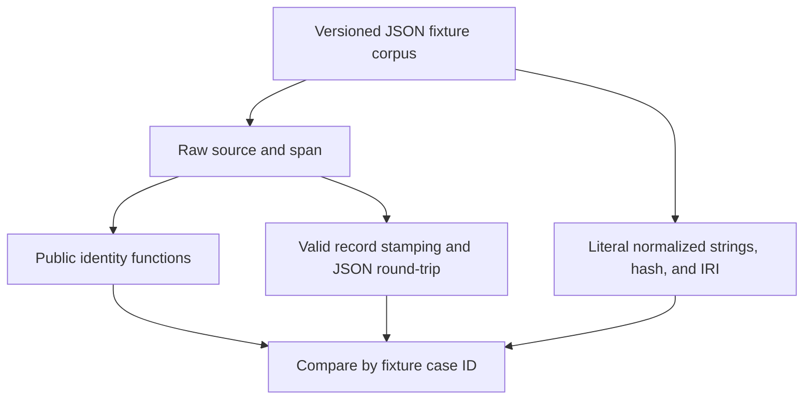

# Shared Shard Identity Consumer Fixtures - Plan

## Goal Capsule

- **Objective:** Consumer developers can check whether their shard identifiers match the identifiers on propositions for the same source and text span.
- **Means:** A reusable corpus of frozen identity examples, local conformance tests, and consumer instructions (KTD1–KTD3).
- **Authority:** The supplied `foli-1` mandate and standing drawdown rules govern this item. The campaign authority is the chief repository's `docs/plans/2026-10-26-0705-feat-codex-drawdown-campaign-plan.md`, limited to its Goal Capsule and R11, R15, R16, R17, R19, and R20. Its source-availability limitation is recorded below. Within this repository, the contract is `README.md` → Content identity and the frozen recipe in `src/folio_propositions/identity.py`.
- **Execution boundary:** This stage produces only a plan commit on `drawdown/foli-1`. The later build stage runs `lfg` on this plan, including implementation, simplification, review, verification, and local commits. The controller owns scanning, pushing, and PR creation; the campaign gate owns merging. This clone must remain without a remote or credential discovery.
- **Stop conditions:** Stop affected work if existing identity constants would change, an existing test would be weakened, or completion would require a migration, data rewrite, release, outside service, credentials, spend, production changes, or messages to people. Report the concrete conflict instead of widening `foli-1`.

---

## Product Contract

### Summary

Add a language-neutral fixture corpus that consumers can copy at a pinned repository revision.
New tests will exercise the public identity functions and proposition-to-shard matching against its fixed expected values.

### Problem Frame

`README.md` promises that a proposition and a folio-insights shard drawn from the same normalized source and span share an IRI.
The repository already has eight inline golden vectors, but consumers cannot reuse them without extracting Python test data.
The existing stamping test derives its expected IRI with the same library it exercises, so it establishes internal agreement rather than agreement with a portable expected value.

### Requirements

**Shared identity examples**

- R1. Provide portable examples containing raw source/span inputs and literal normalized strings, full provenance hashes, and shard IRIs, grounded in the README's content-identity contract.
- R2. Preserve the frozen recipe and all eight existing golden inputs and hashes exactly; changes to normalization, hashing, public APIs, or stored identities are outside this item.

**Consumer verification**

- R3. Add tests for the fixture corpus, including equivalent and distinct identities, while keeping every existing test unchanged (campaign R15–R16).
- R4. Demonstrate that distinct propositions for one source/span join to the same fixture IRI through stamping and JSON round-trip, without mutating the input record.
- R5. Document how consumers reuse the fixtures and report mismatches, with evidence limited to the checks actually run.

**Delivery boundary**

- R6. Keep `foli-1` isolated on `drawdown/foli-1`, with only fixture, test, and related documentation changes in the build stage (campaign R17, R19).

### Scope Boundaries

The proposed file allowlist is:

- `tests/fixtures/shared_shard_identity_v1.json` — new reusable data.
- `tests/test_consumer_compatibility.py` — new tests.
- `docs/consumer-compatibility.md` — new reuse instructions.
- `README.md` — a short link from Content identity.
- `docs/README.md` — documentation index entry.

The committed plan is the only repository change authorized in the current stage.
During implementation, keep `src/`, existing test files, package metadata, dependency declarations, CI, deployment configuration, and evidence-status documents unchanged (R2, R3, R6).
No front-end page changes are planned, so the campaign screenshot requirement does not apply.

Considered and excluded: a runtime fixture loader, packaged fixture API, JSON Schema dependency, generator command, consumer adapter framework, and new CI job.
The corpus is a small repository asset consumed by tests; these mechanisms would add interfaces without improving this item's verification.
Reconsider distribution only in a separate request from a consumer that needs installed-package access.

#### Deferred to Follow-Up Work

- Authorized-signer policy and lifecycle replay examples belong to `foli-2`.
- Broad test-coverage work, dependency/security audits, and unrelated documentation cleanup belong to `foli-3`.
- Running the corpus inside sibling repositories belongs to their own authorized work. It is not a prerequisite for making these fixtures available.
- Additional document-fingerprint fixtures are outside this shared-shard item. The existing opaque URN vector remains in scope; `document_source_uri` retains its existing coverage.

---

## Planning Contract

### Reverified Starting State

The inspected starting commit is `90f94bea43ce6f63176cd6271c7006c72f528dd3`.
The working tree was clean on `drawdown/foli-1`, and no remote was configured.
No repository or ancestor `AGENTS.md`/`CLAUDE.md` was present in the accessible checkout hierarchy; the instructions supplied with the mandate apply.
`docs/handoffs/`, `.planning/`, and `docs/solutions/` were absent.
The existing plan, `docs/plans/2026-10-09-ci-drain.md`, concerns CI rather than this fixture work.

| Evidence | Consequence for this plan |
|---|---|
| `tests/test_identity.py` contains eight literal `GOLDEN` entries and warns against regeneration from this library | Copy their case IDs, inputs, and hashes verbatim into the new corpus; leave the original tests intact. |
| `src/folio_propositions/identity.py` declares its recipe frozen | Test the current contract without changing or extending normalization. |
| `src/folio_propositions/interchange.py` copies records, skips absent/blank text, and checks stamps when source/text are available | Exercise these actual consumer boundaries; do not invent stricter validation. |
| `src/folio_propositions/models.py` requires offsets and text together | Use valid model payloads for fixture-backed stamping tests. |
| `tests/test_interchange.py` already covers stamping, round-trip, and signed-history protection | Add comparisons to frozen fixture IRIs without replacing existing coverage. |
| `docs/shard-mapping.md` describes cross-product matching as pending | Local fixture conformance must not be reported as a live sibling integration result. |
| `.github/workflows/ci.yml` runs pytest, Ruff, and mypy on Python 3.11–3.13, plus an isolated core import | New pytest tests fit the existing checks without workflow changes. |

No tests, installs, or runtime probes were run during planning.
Suite health and interpreter availability remain build-stage observations.

### Authority Availability

The chief repository and its campaign plan were not available in this isolated clone.
The campaign Goal Capsule and cited R-IDs therefore were not independently read; their supplied standing-rule restatement is the available authority for this plan.
Before build acceptance, the controller must compare this plan against those exact campaign sections and resolve any conflict.
This is a controller source-verification prerequisite, not a decision that needs the user or a reason to seek credentials.

### Key Technical Decisions

- KTD1. **Use one UTF-8 JSON corpus with fixture-format version 1.** Its `fixture_version` and `cases` envelope is separate from the package version and `SCHEMA_VERSION`. Each case carries `id`, `source_uri`, `span`, `normalized_source_uri`, `normalized_span`, `provenance_hash`, and `iri`. This keeps R1 usable without Python, pytest, Pydantic, or a new runtime API.
- KTD2. **Treat expected values as reviewed constants.** Preserve the original anchors under R2. For added cases, review the normalized strings against the frozen recipe and calculate the hash independently from their explicit UTF-8 payload. Never generate expected values with the public functions under test, and never regenerate fixtures during test execution.
- KTD3. **Separate shared success cases from library guardrails.** Every portable case has a nonempty source and a span that remains nonempty after normalization. The stamping docstring explicitly records that folio-insights can hash empty spans while this library rejects them. Test this library's rejection and skipping behavior only in the local pytest module; make no sibling error-policy claim (R3, R5).
- KTD4. **Keep publication and acceptance with the controller and campaign gate.** The build produces reviewed local commits under R6. (session-settled: user-directed — chosen over holding every expansion for personal approval: the campaign authorizes expansion merges behind its guardrails.)
- KTD5. **Preserve the campaign's execution model choices.** Local work uses Astra rather than the Sol-first ladder; cloud builds use Codex Cloud's default Sol and still receive Astra and Fable reviews. (session-settled: user-directed — chosen over the earlier model ladder and a forced cloud model: the supplied campaign rules settle those choices.)

### Assumptions

These are bounded planning defaults rather than additional user requirements:

- Repository-based, commit-pinned reuse is sufficient for this fixture deliverable; no wheel distribution is promised.
- Literal normalization outputs make cross-language failures easier to diagnose than hashes alone.
- Existing local golden vectors are the available compatibility anchors. Their comments describe their origin; this stage does not independently verify a current sibling implementation.

### Contract and Data Flow

The recipe owner remains `src/folio_propositions/identity.py`.
Its payload is the normalized source URI, one LF delimiter, and the normalized span encoded as UTF-8.
The full SHA-256 digest is the provenance hash; the shard IRI uses `urn:folio:shard/` followed by its first 32 lowercase hexadecimal characters.
The fixture records expected outputs at each boundary so a consumer can identify the first mismatch.

The corpus is an input to tests, never an output produced by the implementation under test.
A consumer can run the same raw inputs through its own API, using the literal outputs as its oracle.
No folio-insights import, adapter signature, shard envelope, or remote checkout is assumed.

### Risks and Controls

| Risk | Control |
|---|---|
| Fixture and production code drift together | KTD2, unchanged original tests, and independent hashing of literal normalized payloads. |
| Editors erase Unicode or newline distinctions | Use deliberate JSON escapes for decomposed Unicode, CR, LF, and tabs; compare decoded strings exactly. |
| A port over-normalizes paths, queries, fragments, or interior whitespace | U1 includes cases where those distinctions survive and change the expected identity. |
| Local tests are presented as sibling integration evidence | R5 and U3 explicitly retain the external-execution limitation. |
| A discovered baseline failure encourages widening scope | Record the failure separately; preserve tests and stop only the affected acceptance claim. |

External research is unnecessary for these choices: the repository owns the frozen recipe, existing golden values, and consumer-facing promise.
No new technology or external option selection is involved.

---

## Implementation Units

### U1. Publish and verify the portable identity corpus

**Goal:** Consumers can check identity results against reusable literal examples.

**Requirements:** R1–R3, R6. **Dependencies:** None.

**Files:** Create `tests/fixtures/shared_shard_identity_v1.json` and `tests/test_consumer_compatibility.py`.

**Approach:** Apply KTD1–KTD3. Load the data relative to the test module with explicit UTF-8 decoding and stable case IDs in pytest output. Use a small test-local loader; verify version, nonempty case collection, unique IDs, required string fields, and hash/IRI shape without adding a validation framework. Preserve the eight anchors as separate unchanged cases, including the NFC/NFD path pair.

**Patterns to follow:** `tests/test_identity.py` for literal vectors and parametrization; `src/folio_propositions/identity.py` for the exact contract.

**Execution note:** Establish fixture expectations independently before comparing the public APIs. A mismatch calls for investigation, not snapshot regeneration.

**Test scenarios:**

1. All eight original IDs, raw inputs, and provenance hashes appear unchanged: `plain-ascii`, `scheme-host-case-trailing-slash`, `nfc-path`, `nfd-path`, `crlf-span`, `surrounding-whitespace`, `query-and-fragment`, and `urn-uri`.
2. Each case's public normalizer outputs, full identity, and `content_iri` match its literal fields; independently hashing the stored normalized payload agrees with its hash and IRI.
3. Equivalent scheme/host case and non-root trailing slash inputs retain equal hashes. Unicode NFC/NFD paths and spans, LF/CRLF/bare CR spans, and surrounding whitespace variants also retain their expected identities.
4. Changed source, changed span, separately changed query, and separately changed fragment each produce distinct pinned identities.
5. Root slash versus no root slash, path case, interior spaces/tabs, and already-percent-encoded paths retain the distinctions required by the frozen recipe. Do not decode percent escapes, collapse interior whitespace, lowercase paths, or double-encode percent signs.
6. Empty source, empty span, and whitespace-only span raise `ValueError` through both public identity entry points. These are local API tests outside the portable corpus (KTD3).
7. Fixture integrity failures identify the case or field involved; parametrized comparisons name the failing case. The loader must fail rather than silently skip an unsupported format or malformed entry.

**Verification:** The new test module consumes the committed JSON and proves R1–R3 without modifying any original test, runtime file, or dependency.

### U2. Prove fixture-backed proposition-to-shard joins

**Goal:** A consumer can see that separate propositions match one frozen shard identifier.

**Requirements:** R3, R4, R6. **Dependencies:** U1.

**Files:** Extend the new `tests/test_consumer_compatibility.py`.

**Approach:** Construct valid public models from U1 cases and compare stamps directly with fixture IRIs. Use the established `spanned` pattern from `tests/test_interchange.py`, with offsets and text supplied together. Keep per-proposition IDs, attribution, and document metadata independent of the identity pair; no consumer application schema is introduced.

**Test scenarios:**

1. Two propositions with different IDs, `Legal Proposition`/`Factual Statement` types, and different asserters share one fixture IRI for the same source/span.
2. Changing extraction IDs, offsets, generator information, or document metadata leaves that stamp unchanged. Raw text and these non-identity fields survive stamping.
3. Stamping leaves the original record unchanged, is idempotent on an unsigned record, and survives JSON serialization and validation with the same IDs and stamps.
4. Fixtures with different sources or spans yield distinct join keys in otherwise equivalent records.
5. Missing text and normalized-empty text remain unstamped in a record that also contains a valid nonempty proposition.
6. A missing source prevents stamping. A record without a source can still carry a syntactically valid stamp under existing validation rules; this does not establish verified identity.
7. A syntactically valid but wrong stamp is rejected when its source and text are supplied. Compare against literal fixture values, not a second call to the stamping implementation.

**Verification:** Fixed expected shard IRIs prove the join independently of the library's own expected-value calculation. The complete existing lifecycle suite remains the regression check for signed-history behavior; this unit adds no signing or replay examples.

### U3. Make consumer reuse discoverable and precise

**Goal:** A developer can reuse the corpus without depending on this repository's pytest internals.

**Requirements:** R1, R5, R6. **Dependencies:** U1, U2.

**Files:** Create `docs/consumer-compatibility.md`; update `README.md` and `docs/README.md`.

**Approach:** Explain the fixture envelope, field meanings, original-anchor provenance, and independently checked extensions. Describe copying the file from a pinned commit, using raw inputs without pre-normalizing them, comparing each output stage, and reporting fixture revision, case ID, expected value, and actual value. Link the local verification command and show a small reader example that consumes the same corpus. Identify the fixture-backed join test as local conformance evidence; preserve the distinction from execution inside folio-enrich or folio-insights.

**Patterns to follow:** The brief Content identity section in `README.md`, the link style in `docs/README.md`, and the evidence qualification in `docs/shard-mapping.md`.

**Test expectation:** No new behavioral test is needed for prose. During build, execute any added reader example against the committed fixture and check links and named case IDs; U1 and U2 remain the behavioral proof.

**Verification:** Documentation matches the actual file and consumer test, promises no installed-package fixture API, and states that external consumer execution remains unverified.

---

## Verification Contract

These checks belong to the build stage; planning makes no passing-test claim.
Recheck the branch, diff, and baseline before implementation because other work may have advanced the repository.
Use the development setup already documented in `README.md`, using the provided dependency cache where needed.

| Check | Command or evidence | Required outcome |
|---|---|---|
| Baseline | `.venv/bin/pytest -q`, `.venv/bin/ruff check .`, `.venv/bin/mypy src` before edits | Record actual results and distinguish pre-existing failures. |
| Fixture and join behavior | `.venv/bin/pytest -q tests/test_consumer_compatibility.py tests/test_identity.py tests/test_interchange.py` | All new cases and existing identity/interchange checks pass. |
| Full regression | `.venv/bin/pytest -q` | Existing model, interchange, identity, and lifecycle suites pass unchanged. |
| Lint and types | `.venv/bin/ruff check .` and `.venv/bin/mypy src` | Existing repository quality gates pass. |
| Consumer reuse example | Execute the documentation's reader example against the repository corpus | It reads the declared format and compares pinned values without test-module imports. |
| Change boundary | Review the diff against the recorded baseline | Only the allowlisted build files and the committed plan changed; every pre-existing test is byte-for-byte unchanged. |
| Supported interpreters | Existing CI matrix after controller publication | Report Python 3.11–3.13 and isolated core-import results only when observed; do not claim matrix coverage from one local interpreter. |

The build receipt must distinguish local fixture results, unavailable environment checks, and any downstream executions actually observed.
No screenshot or held change is expected within the file allowlist.

---

## Definition of Done

- U1's corpus preserves the eight original anchors and includes the specified normalization boundaries with literal reviewed outputs.
- U2 proves the join, copy, round-trip, and validation behavior against fixture constants.
- U3 makes reuse and evidence limits clear from the README entry point.
- The Verification Contract passes with truthful execution receipts; existing tests and runtime behavior remain unchanged.
- No abandoned helper, generator, or experimental artifact is retained in the build diff.
- The controller has checked the unavailable campaign authority sections before accepting the build.
- The branch contains only `foli-1` work and is committed locally for controller publication, without remote or credential changes.
