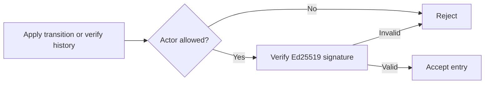
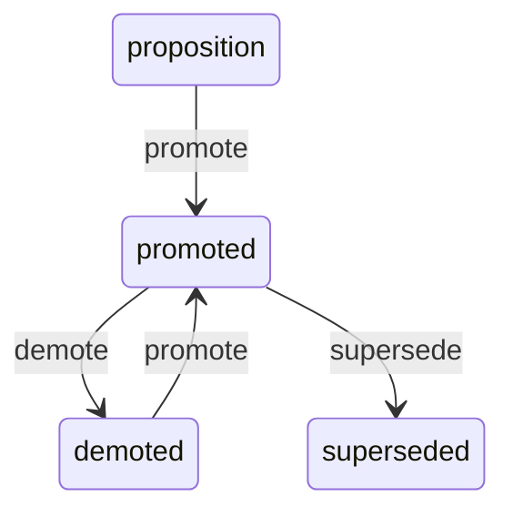
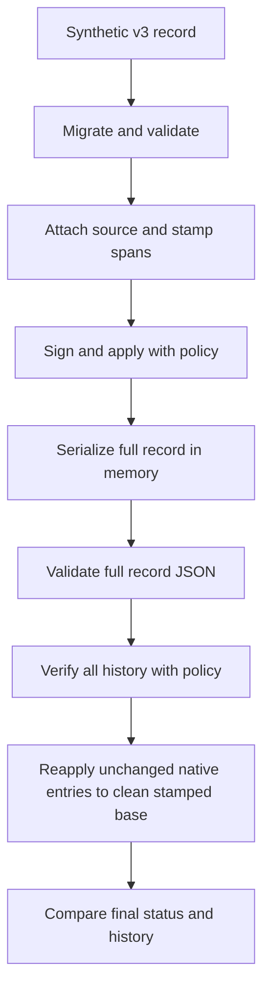
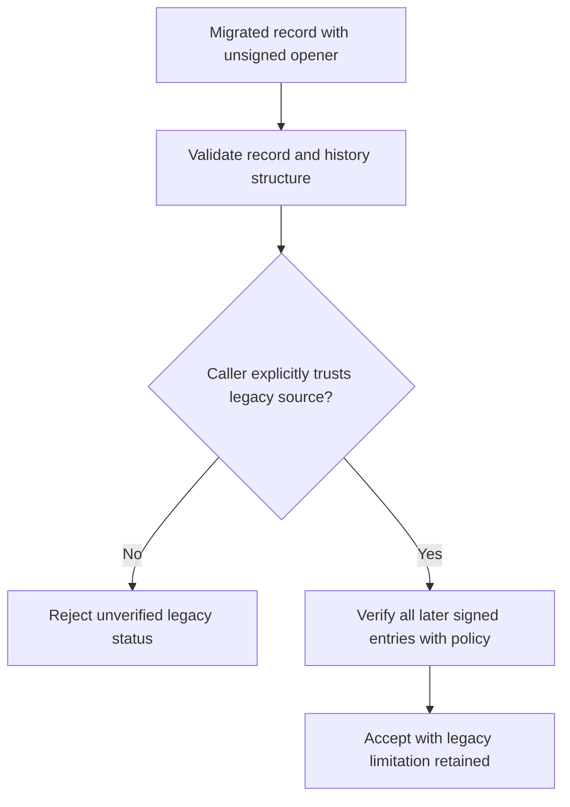

# Authorized Signer and Lifecycle Migration Examples - Plan

## Goal Capsule

- **Objective:** Consumer developers can migrate a v3 record and follow a complete v0.4 example that distinguishes an authorized signed lifecycle from an unsigned legacy status claim.
- **Means:** A runnable consumer example, integration tests of that example, and guidance in the existing migration document (KTD1–KTD5).
- **Authority:** The supplied `foli-2` mandate and standing lane rules govern this item. The chief repository's `docs/plans/2026-10-26-0705-feat-codex-drawdown-campaign-plan.md` is the campaign authority; its Goal Capsule and campaign R11, R15, R16, R17, R19, and R20 are the requested excerpts. Source availability is recorded under Assumptions. `README.md` and `docs/migration-0.4.0.md` supply this repository's behavioral contract.
- **Execution profile:** This stage writes and locally commits the plan only. A later controller-directed build runs `lfg` on this plan, implements, simplifies, reviews, verifies, and commits locally. The controller handles push and PR creation; the campaign merge gate handles merging (campaign R15, R19).
- **Boundary:** Work only `foli-2` on `drawdown/foli-2` (campaign R17). Do not add a remote, seek credentials, or perform publication from this clone.
- **Stop conditions:** A newly discovered requirement for a schema migration, data rewrite, release, outside service, or forbidden operation is outside this plan. Preserve completed work and report the specific gap; no such requirement is currently identified.

---

## Product Contract

### Summary

Add a self-contained migration example showing caller-owned signer authorization, saved-history verification, and lifecycle replay.
Extend the v0.4 migration guide so a developer can run the example and understand each trust decision.

### Problem Frame

The existing guide supplies migration and signing fragments whose inputs are undefined.
It warns that a valid `did:key` signature does not establish authorization, but it supplies no policy implementation or complete replay walkthrough.
The library already has detailed migration and lifecycle tests; the missing piece is a consumer example that composes those contracts correctly.

### Requirements

**Consumer trust and replay**

- R1. Provide runnable migration examples grounded in the existing v3-to-v4 migration, content stamping, and signed lifecycle described in `docs/migration-0.4.0.md` and `README.md`.
- R2. Demonstrate that accepting a new signed transition or saved signed history requires both an authorized `actor_did` and a valid signature.
- R3. Explain legitimate saved-history replay and rejection of obsolete signed transitions using the existing sequence, identity, timestamp, and terminal-state rules.
- R4. Demonstrate default rejection of an unsigned legacy `migrate` entry and deliberate caller-controlled legacy trust, while retaining authorization and signature checks for subsequent signed entries.

**Compatibility and delivery**

- R5. Add tests of the delivered examples and keep every existing test and behavior intact (campaign R15, R16).
- R6. Use synthetic data and ephemeral in-memory demo keys; require no credentials, persistent data changes, network service, new dependency, schema migration, or package release.
- R7. Keep the change within this item's branch and the supplied campaign safety/publication rules (campaign R11, R15–R17, R19, R20).

### Acceptance Examples

- AE1. A valid signature from a signer outside the caller's allowlist is refused during both transition application and saved-history acceptance. Covers R2.
- AE2. A source-bearing record with a valid native signed history reloads, verifies under the supplied policy, and reproduces the same lifecycle state from its recorded transitions; appending its old demotion again fails. Covers R1, R3; replay interpretation is A1.
- AE3. Migrating a legacy promoted proposition produces an unsigned opener. Default verification rejects it; explicit trusted-source opt-in permits that opener but still rejects an unauthorized or tampered later signed entry. Covers R4.

### Scope Boundaries

Expected implementation changes are `examples/migration_v4.py`, `tests/test_migration_examples.py`, `docs/migration-0.4.0.md`, and a short link in `README.md`.
No changes are planned to `src/folio_propositions/`, package exports, `pyproject.toml`, or `.github/workflows/ci.yml`.
This item demonstrates the migration already implemented in the library; it does not add or execute a new stored-data migration.

No user interface changes are planned, so Playwright screenshot evidence is not applicable.
If the scope unexpectedly acquires a front-end change, the campaign screenshot requirement still applies: commit the changed-page screenshot under `docs/plans/evidence/` and report its path.

Historical authorization policies, revocation services, policy storage, generalized ingestion/replay APIs, and external history checkpoints were considered and excluded.
The example checks a presented history against a caller-supplied current policy; it cannot prove that an omitted suffix never existed or that a signer was authorized at an earlier date.
Requirements for those guarantees would need a separate item.

#### Deferred to Follow-Up Work

Shared-shard compatibility fixtures belong to `foli-1`.
Broad coverage, CI, dependency auditing, and unrelated documentation cleanup belong to `foli-3`.

---

## Planning Contract

### Verified Starting State

Static inspection on 2026-10-26 found a clean `drawdown/foli-2` at commit `90f94be`.
No repository `AGENTS.md`, `CLAUDE.md`, `docs/handoffs/`, or `.planning/` was present.
The only existing plan, `docs/plans/2026-10-09-ci-drain.md`, addresses CI rather than this item.
No runnable example directory or consumer authorization adapter was present.
No tests or runtime probes were run during planning; baseline results must be established at build start.

| Evidence | Consequence for this plan |
| --- | --- |
| `src/folio_propositions/interchange.py`: `migrate_record`, `_migrate_v3_to_v4` | Migration copies its input and preserves a legacy status through an unsigned opener. Reuse it unchanged. |
| `src/folio_propositions/interchange.py`: record validator and `stamp_content_iris` | Source/span binding is checked at record validation when context is present. Stamp before signing. |
| `src/folio_propositions/models.py`: `_validate_axiom_history` | Model validation checks chain, sequence, timestamps, legacy placement, and final status. |
| `src/folio_propositions/lifecycle.py`: `apply_transition`, `verify_history` | Applying checks the new entry; history verification checks signatures and legacy opt-in. Neither substitutes for validating untrusted serialized data. |
| `src/folio_propositions/signing.py`: `DidKeyEd25519Verifier` | Cryptographic verification is independent of consumer authorization. The protocol permits a composing verifier. |
| `tests/test_lifecycle.py`, `tests/test_interchange.py` | Reuse real in-memory signers, fixed increasing UTC times, synthetic records, and immutability assertions; avoid duplicating the exhaustive transition matrix. |
| `pyproject.toml`, `.github/workflows/ci.yml` | Existing signing/dev extras and pytest discovery support the example tests; core-only imports must remain independent of cryptography. |

### Assumptions

- A1. “Lifecycle replay” includes both re-verifying saved history and reconstructing a native signed history from its unchanged recorded transitions. This is an explicit interpretation of the mandate, not a new library guarantee.
- A2. One checkout-relative script with two named demonstrations is sufficient; the example need not be installed in the package wheel. The wheel currently packages only `src/folio_propositions`.
- A3. A copied immutable set of allowed actor DIDs is an adequate teaching policy. Real policy selection remains the consumer's responsibility.
- A4. The chief campaign file and `ops/drawdown/mandates/_common.md` were not supplied in this sandbox. Their contents could not be independently checked; campaign R-ID references here trace to the user's supplied standing rules. The controller should reconcile the named excerpts before the build handoff. This availability gap does not require a product decision from the user.

### Key Technical Decisions

- KTD1. **Keep the example outside the library.** Put the walkthrough in `examples/migration_v4.py`, using existing public package APIs and the installed signing extra. Small helpers make the actual example testable without exporting new library behavior. Follows R1, R5, R6 and A2.
- KTD2. **Compose authorization with verification.** A consumer `TransitionVerifier` adapter copies the allowed-DID set, denies nonmembers, and delegates authorized members to `DidKeyEd25519Verifier`. Pass this adapter to both application and history verification. Keep the existing boolean protocol and `AxiomSignatureError` failure path; documentation must explain that an effective verification failure can also mean policy denial. Follows R2 and A3.
- KTD3. **Validate, then verify, then consume.** Reload the complete source-bearing record through `PropositionDocumentRecord` JSON validation, then verify every history entry with KTD2 before replay or further append. Keep helpers scoped to the synthetic source-bearing fixtures. Do not claim this is a generic validator for records whose optional source/text context is absent. Follows R2, R3.
- KTD4. **Separate native reconstruction from legacy trust.** Reconstruct only the native example from a clean stamped proposition with matching identity, applying recorded entries unchanged. The legacy example retains its migration opener and uses explicit caller-owned legacy opt-in after validation. It never sends `migrate` to `apply_transition` or erases history to make replay work. Follows R3, R4 and A1.
- KTD5. **Test the shipped script with real signatures.** Load example helpers by file path with the standard library; do not import test fixtures into the script or copy its policy into tests. Use fresh generated keys, fixed increasing UTC timestamps, and assertions about state/history rather than fixed key or signature bytes. Follows R5, R6.
- KTD6. **Carry the campaign execution decisions forward.** Local work uses Astra (session-settled: user-directed — chosen over the Sol-first ladder: the campaign specifies Astra locally). Cloud builds use the default Sol model and retain Astra/Fable review gates (session-settled: user-directed — chosen over carrying the local model choice into cloud builds: the campaign explicitly separates those stages). Follows R7.
- KTD7. **Leave publication to the campaign.** This clone commits locally; the controller and merge gate complete delivery. Expansions merge behind guardrails (session-settled: user-directed — chosen over holding every expansion for user review: the campaign authorizes guarded merging). Do not wait for routine user approval (session-settled: user-directed — chosen over waiting on the user: the campaign requires autonomous progress). Follows R7.

### Trust and Replay Flows

The adapter composes two checks; allowlisting alone is insufficient (KTD2):

The native walkthrough demonstrates the existing lifecycle, without changing its table (R3):

This diagram shows the walkthrough's route; the library also allows direct supersession from proposition and demoted states.

Saved native data passes each boundary before reconstruction (KTD3, KTD4):

Legacy acceptance has a separate trust decision (R4):

### Risks and Limits

A caller must supply authorization policy independently of the record being checked.
The example must never derive trust from the imported record's own signers or a serialized “trusted” flag.
The legacy opt-in must remain separate from the normal default path.

Unexpected errors must propagate; demonstrations of expected rejections catch only the documented exception types.
Successful appending must not be described as approval of prior history, and JSON validation must not be described as signature verification.
The existing wire payload, core dependency boundary, and saved-record formats remain unchanged under R6.

---

## Implementation Units

### U1. Runnable authorized native lifecycle and replay

**Goal:** Deliver the complete native migration-to-replay example.

**Requirements:** R1–R3, R5–R7; AE1, AE2; KTD1–KTD7.

**Dependencies:** None; establish the build baseline first.

**Files:** Create `examples/migration_v4.py` and `tests/test_migration_examples.py`.

**Approach:**

1. Build a synthetic v3 record with a plain proposition, then migrate, validate, attach source identity, and stamp the nonempty text.
2. Add the consumer adapter and in-memory signer setup using KTD2 and KTD5.
3. Exercise the native lifecycle route, retain the pre-supersession snapshot for stale-event rejection, and implement the KTD3/KTD4 reload and reconstruction flow.
4. Expose small example helpers and a main entry point; emit a concise outcome summary without key material.

**Patterns to follow:** `Signer`, `signed`, and `advance` in `tests/test_lifecycle.py`; synthetic records and immutability assertions in `tests/test_interchange.py`.

**Test scenarios:**

1. Covers AE2. The native walkthrough finishes superseded, preserves sequential history and stamped identity, and reconstructs an equal status/history without changing the original v3 input or prior proposition snapshots.
2. Covers AE1. A correct signature from a second, disallowed signer passes the bare cryptographic verifier but fails the example's apply and saved-history acceptance paths; an empty allowlist also rejects.
3. An allowed signer's tampered reason fails effective verification, proving allowlisting cannot bypass signature checking.
4. A structurally valid saved history with an unauthorized earlier actor and an authorized final actor fails acceptance. Rechecking an initially accepted history under a policy excluding an earlier signer also fails.
5. Changed source/text with the old content IRI fails full-record validation; an illegal sequence/final-state edit also fails validation before the history is consumed.
6. Covers AE2. Re-appending the old demotion to the promoted snapshot fails with `IllegalAxiomTransition` and leaves the snapshot unchanged. Reusing its signature for a different proposition identity fails verification.

**Verification:** The tests exercise the delivered helpers and real signatures. Native reconstruction uses the same recorded transitions, not freshly signed replacements. Existing lifecycle/interchange tests remain unchanged.

### U2. Explicit legacy trust example

**Goal:** Show how migrated nondefault status differs from native signed history.

**Requirements:** R1, R2, R4–R7; AE3; KTD2–KTD7.

**Dependencies:** U1.

**Files:** Extend `examples/migration_v4.py` and `tests/test_migration_examples.py`.

**Approach:** Add a separate synthetic v3 promoted proposition and follow KTD4. Demonstrate default rejection before explicit caller-owned opt-in, then append a legal signed transition to the retained anchor and verify the resulting history. Keep this path separate from native reconstruction.

**Patterns to follow:** `test_v3_to_v4_migration_adds_history_and_legacy_migrate_entry` in `tests/test_interchange.py` and `test_verify_history_detects_tampering_and_gates_migrate` in `tests/test_lifecycle.py`.

**Test scenarios:**

1. Covers AE3. Migration produces the unsigned sequence-zero opener, leaves the input untouched, and fails default verification both before and after a valid signed append.
2. Covers AE3. Explicit legacy trust permits the opener and authorized later entries; the next signed entry uses sequence one and the opener remains unchanged.
3. Covers AE3. Legacy trust still rejects a disallowed later signer or a tampered later signature. A malformed extra/noninitial migrate entry fails structural validation before trust is considered.

**Verification:** The example demonstrates an accepted legacy claim without describing it as a verified historical decision. It never submits or signs the legacy opener as a normal lifecycle action.

### U3. Publish the runnable guidance within the repository

**Goal:** Make the examples discoverable and explain their trust boundaries accurately.

**Requirements:** R1–R7; KTD1–KTD7.

**Dependencies:** U1, U2.

**Files:** Update `docs/migration-0.4.0.md`, `README.md`, and the entry-point coverage in `tests/test_migration_examples.py`.

**Approach:** Extend the existing migration guide with checkout/signing-extra prerequisites, a runnable command, expected outcomes, and links to the canonical script. Update the current bare-verifier fragment to point to or consistently use the authorization example. Explain KTD2–KTD4 and preserve the guide's forward-only migration/original-record rollback advice. Add a short README link beside its lifecycle guidance; `docs/README.md` already links the migration guide.

**Test scenarios:**

1. Running the actual script entry point with the documented environment succeeds, exercises native and legacy demonstrations, and prints their expected outcomes. Unexpected failures remain visible.
2. Confirm the documented command addresses the checkout script rather than promising a wheel-installed CLI; manually check the relative links and names against the implemented file.

**Verification:** A reader can run the example without supplying a proposition, DID, private key file, service, or sibling repository. The prose and tests refer to the same example code.

---

## Verification Contract

Build verification uses the existing development/signing environment described in `README.md`.
Use available cached dependencies where needed; never acquire credentials or weaken checks to accommodate the sandbox.
Record baseline failures before implementation and distinguish them from regressions.

| Check | Timing and acceptance |
| --- | --- |
| Existing pytest, Ruff, and source mypy checks from `README.md` | Run before implementation to establish the baseline, then after the scoped change; preserve all existing tests. |
| Focused `tests/test_migration_examples.py` with `tests/test_lifecycle.py` and `tests/test_interchange.py` | All consumer scenarios above pass against real signatures and the actual example code. |
| Documented `examples/migration_v4.py` entry point | Both demonstrations complete from a checkout with the existing signing extra; no credentials or external services are needed. |
| Ruff over the repository and mypy over source plus the new example | The new script satisfies the same lint rules and receives explicit type checking, since existing CI mypy targets only source. |
| Core-only isolated import check from `.github/workflows/ci.yml` | Core import remains possible without cryptography; do not import example code from package initialization. |
| Existing CI matrix, Python 3.11–3.13 | Controller-run CI provides versions unavailable locally. Report any local coverage limitation accurately. |
| Documentation and diff inspection | Links resolve; expected failures are correctly explained; no source/schema/package/CI changes or secret material enter the diff. |

No Playwright capture is required for this documented script example.
No schema deployment, data rewrite, or package release verification applies.

---

## Definition of Done

- U1 supplies the authorized native lifecycle and replay demonstration; U2 supplies the separate legacy trust demonstration; U3 makes both runnable from the existing documentation.
- The consumer integration tests and existing required checks pass, with baseline/environment limitations reported rather than hidden.
- Public APIs, stored formats, dependency boundaries, and existing tests remain intact.
- No experimental or abandoned-attempt code is included in the committed diff.
- The build is simplified, reviewed, and locally committed on `drawdown/foli-2`; the controller receives the plan path and truthful verification evidence for publication.
- No user decision, held schema/data change, or outside service is currently required. Any newly discovered blocker is reported under the campaign's required final heading and format.
