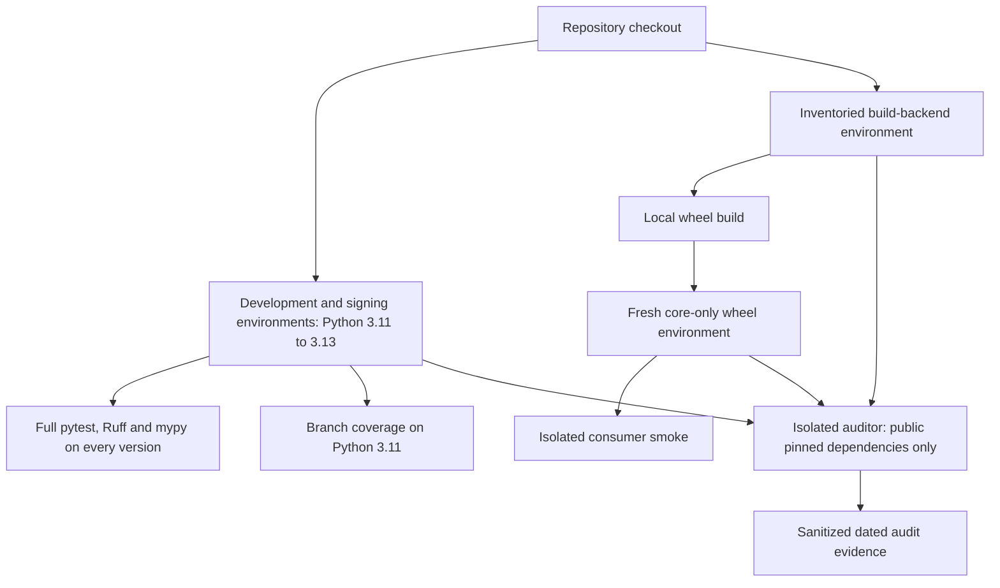

# Foli-3 Maintenance Assurance - Plan

## Goal Capsule

- **Objective:** Maintainers can change `folio-propositions` with evidence that documented consumer operations still work and dependency risks have been checked.
- **Means:** Extend existing tests and CI, verify an installed core-only wheel, and align maintenance documentation with the code (KTD1–KTD5).
- **Authority:** The controller's `foli-3` mandate and standing drawdown rules; the chief repository's `docs/plans/2026-10-26-0705-feat-codex-drawdown-campaign-plan.md`, Goal Capsule and R11, R15, R16, R17, R19, R20; applicable repository instructions when present. Campaign R-IDs are separate from this plan's local R-IDs.
- **Authority availability:** The chief repository and campaign file are not mounted in this clone. The supplied standing rules are the available campaign evidence; no claim is made to have read the missing Goal Capsule or R-ID text. The controller must cross-check those sections before dispatching the build.
- **Execution boundary:** This stage creates and locally commits only this plan on `drawdown/foli-3`. The later build stage runs `lfg` on the plan, implements and reviews locally, and leaves publication to the controller under R7.
- **Stop conditions:** Preserve the boundaries in R5–R7. If an essential external input remains unavailable, finish independent work and report the specific blocked outcome without claiming completion.

---

## Product Contract

### Summary

Add focused regression coverage and repeatable maintenance checks around the existing public API.
Extend the current CI workflow with coverage evidence, installed-package checks, and dependency audits, then document the verified behavior and maintenance commands.

### Problem Frame

This repository already has four pytest modules and CI; the mandate catalog did not run them.
Static inspection finds several public error and copy-ownership paths without direct assertions, while the dependency-light CI job checks import alone.
There is no configured coverage measurement or dependency audit, and the README describes lifecycle mutation more strongly than the implementation enforces.
Maintainers need evidence for those boundaries before relying on future changes.

### Requirements

**Consumer behavior**

- R1. Add meaningful tests for common public operations and their failure paths, preserving every existing test and assertion.
- R2. Keep the complete existing pytest, Ruff, and mypy checks on Python 3.11, 3.12, and 3.13, and strengthen the independent check that core usage works without `cryptography`.

**Maintenance evidence**

- R3. Produce repeatable dependency-audit evidence and a focused source/workflow security review, distinguishing known findings from incomplete checks.
- R4. Make current development instructions and public behavior claims match the implementation and the checks actually performed.

**Scope and delivery**

- R5. Work only `foli-3`; retain current public APIs, identity and signing formats, schema/package versions, and supported behavior.
- R6. Add no schema migration, stored-data rewrite, package release, outside service integration, credential or security-setting change, spend, sends, force-push, or deletion without verified backup. Use synthetic test data and ephemeral in-memory test keys only; never read credential files, `.env*`, `*.pem`, `*.key`, or the prohibited secret directories. Committed writing and evidence must be public-safe and use repository-relative paths.
- R7. Keep this item on `drawdown/foli-3`, with local commits only in the sandbox. Do not add a remote or seek credentials; the controller scans, pushes and opens the PR, and the campaign merge gate owns merging and required reviews. Report genuine human-input blockers with the requested setting, minutes, and unblocked outcome after completing independent work.

### Key Decisions

- **Complete durable hygiene within the assigned item** (session-settled: user-directed — chosen over speculative features when the campaign reaches hygiene: finish useful maintenance work). Governs R1–R5.
- **Use the campaign gate without another routine approval round** (session-settled: user-directed — chosen over holding guarded changes for personal review: the campaign owns review and merging). Governs R6–R7.
- **No work waits for user time through 2026-10-30** (session-settled: user-directed — chosen over waiting for synchronous decisions: finish independent work and report only essential residual inputs). Governs R7.

### Scope Boundaries

This item changes tests, development tooling, CI, and current documentation.
It adds no frontend, so the screenshot rule has no applicable page.
Historical review dispositions, annotation evidence, and earlier schema decisions remain historical records.

#### Deferred to Follow-Up Work

Shared-shard consumer compatibility fixtures belong to `foli-1`.
Authorized-signer policy and lifecycle migration examples belong to `foli-2`.
Reuse any such work present at build intake; do not duplicate it here.

#### Considered and Not Built

- Model immutability and assignment validation: the README overstatement is corrected through R4; changing mutation semantics would alter the public contract. Reconsider only as a separately scoped behavior change.
- A new lockfile policy, dependency-update bot, hosted coverage dashboard, and custom audit framework: existing uv, pytest, GitHub Actions, and local reports can meet this mandate. Reconsider only if an observed maintenance failure requires them.
- Exhaustive combinatorial fuzzing and a percentage target guessed before measurement: prioritize specific public outcomes and an observed coverage baseline under KTD2.

---

## Planning Contract

### Verified Starting State

Source inspection at commit `90f94bea43ce6f63176cd6271c7006c72f528dd3` found a clean `drawdown/foli-3` worktree.
No repository `AGENTS.md`, `CLAUDE.md`, `docs/handoffs/`, `.planning/`, or `docs/solutions/` is present.
`docs/plans/2026-10-09-ci-drain.md` describes earlier CI work already represented in the current workflow.

| Surface | Observed state | Planning consequence |
|---|---|---|
| `pyproject.toml` | Package 0.4.0; Python >=3.11; Pydantic >=2.7,<3; optional cryptography >=46; pytest, mypy and Ruff in development extras; Hatchling backend | Retain the package and dependency boundaries; add measurement tooling only to development dependencies |
| `.github/workflows/ci.yml` | Full pytest/Ruff/mypy matrix on 3.11–3.13; independent core-only editable import check; read-only contents permission and PR cancellation | Extend the existing jobs and preserve their checks and permissions |
| `tests/test_identity.py`, `tests/test_models.py` | Golden identity vectors, normalization, model validation, and an import test that blocks cryptography | Preserve these tests; avoid repeating the separate compatibility-fixture lane |
| `tests/test_interchange.py` | Historical migration happy paths, stamping, signed-IRI protection, value idempotence, and source preservation | Add dispatch failures and detached-copy assertions where absent |
| `tests/test_lifecycle.py` | Transition grid, signature tampering, canonical payload, replay, timestamps, history, and legacy-entry policy | Add targeted parser-boundary coverage and custom-verifier core proof, without redesigning trust policy |
| `README.md` | Says lifecycle status changes only through `apply_transition` | Describe the supported operation accurately; models are mutable and structural validation does not verify signatures |

No tests, package imports, builds, installations, or audits ran during planning.
Passing status, measured coverage, resolved package versions, and advisory results remain build-stage evidence.

### Assumptions

- There is no usage telemetry in this clone. README entry points and exported consumer workflows are the proxy for “most-used paths,” not a measured usage ranking.
- Public package metadata and the existing PyPI advisory endpoint can be queried without accounts or credentials. If unavailable, record an incomplete audit and preserve a failing gate rather than silently substituting a service.
- The controller can supply the missing campaign authority cross-check. It is an orchestration prerequisite, not a decision to defer to the user.

### Key Technical Decisions

- KTD1. **Characterize existing contracts before changing code.** Extend normal pytest factories and parametrization in place, and use a separate `tests/test_signing.py` for direct signing boundary tests. New tests use current documented results as the oracle; unexpected failures require diagnosis, not a new acceptance policy. Any necessary source fix must be a minimal compatible correction backed by a regression (R1, R5).
- KTD2. **Measure branches with standalone coverage.py on Python 3.11.** Explicitly include `src/folio_propositions`, report missing paths, and keep portable paths in `pyproject.toml`. Before adding cases, measure the existing suite with the same configuration and dependency resolution used afterward. Record per-module statement/branch results; require no regressions and coverage of each selected gap. Set the persistent total-coverage floor to the measured post-change total rounded down to a whole percent. Do not add omissions, exclusions, skips, or weakened assertions to reach it. The other Python legs retain their full suites. [Coverage configuration](https://coverage.readthedocs.io/en/latest/config.html) and [report semantics](https://coverage.readthedocs.io/en/latest/commands/cmd_report.html) support this without a pytest plugin (R1–R2).
- KTD3. **Test the wheel in a separate core-only environment.** A stdlib-only `tests/core_smoke.py` runs with isolated Python, outside pytest's configured source path. Assert that the imported package is the non-editable wheel installation, cryptography is absent, and `py.typed` is included. Build using the same explicitly inventoried backend environment that U3 audits, then install only the wheel and its core dependencies into the smoke environment. Keep its evidence separate from source coverage. [Python isolated mode](https://docs.python.org/3.11/using/cmdline.html#cmdoption-I), [package resources](https://docs.python.org/3.11/library/importlib.resources.html), and [uv build](https://docs.astral.sh/uv/reference/cli/#uv-build) define these boundaries (R2).
- KTD4. **Audit exact tested dependency resolutions with isolated pip-audit.** Audit each Python matrix environment with development/signing extras, the wheel's core environment, and the actual build-backend environment. Export their full transitive public package pins; exclude exactly the local `folio-propositions` distribution and record its version and wheel hash separately. Reject unexpected editable, direct-URL, or unpinned inputs before transmission. Use pip-audit's explicit PyPI service, pinned-input/no-resolver mode, strict collection, JSON output, and bounded timeouts; record the auditor and uv versions outside the application inventories. Findings, unexplained skips, malformed reports, and failed network/collection checks remain failures. Never automatically fix or suppress findings. This establishes dated resolution-specific results, not safety for every version allowed by the manifest. [PyPA pip-audit](https://github.com/pypa/pip-audit#usage), [uv freeze](https://docs.astral.sh/uv/reference/cli/#uv-pip-freeze), and [PyPI advisory metadata](https://docs.pypi.org/api/json/) support this existing-registry approach (R3, R6).
- KTD5. **Correct current docs without changing trust semantics.** `Proposition` validates history structure at construction; `apply_transition` verifies the new entry and returns a copy; `verify_history` explicitly checks recorded signatures through the supplied verifier. Neither the model nor a self-certifying DID supplies consumer authorization policy. Explain those limits in the README and link to existing migration guidance; leave the new migration examples to `foli-2` (R4–R5).
- KTD6. **Preserve campaign model and review routing.** Local work uses Astra (session-settled: user-directed — chosen over the Sol-first ladder: retain the campaign's local execution choice). Cloud build stages use Codex Cloud's default Sol (session-settled: user-directed — chosen over local-model routing for cloud builds: preserve the 2026-10-26 cloud decision). Every cloud PR still needs the campaign's Astra and Fable reviews; the local document review does not satisfy that later gate (R7).

### Check Boundaries

### Risks and Implementation-Time Unknowns

The initial full-suite status and numeric coverage floor cannot be determined from static inspection.
Recheck the branch at build intake and incorporate concurrent lane work without weakening existing tests.
A verified advisory may justify raising a dependency minimum within existing compatibility boundaries; test that change across the preserved matrix and record the advisory basis.
Changes that require a new public contract, schema, security policy, or outside service remain outside R5–R6.

The model boundary is structurally and cryptographically distinct: test stubs establish the custom-verifier protocol, while the existing Ed25519 suite establishes cryptographic behavior.
An unreachable package registry, unavailable local interpreter, or denied Unix socket is an environment limitation, not evidence that a check passed.
Record remaining execution gaps for the controller's CI; do not claim campaign acceptance before those gaps close.

---

## Implementation Units

### U1. Cover public failure paths and copy ownership

**Goal:** Protect useful contracts not directly asserted by the current suites.

**Requirements:** R1, R5–R6; KTD1.

**Dependencies:** Build-stage baseline of the unchanged existing suites.

**Files:** Extend `tests/test_interchange.py`; add `tests/test_signing.py`. Read `src/folio_propositions/interchange.py`, `src/folio_propositions/signing.py`, and `tests/test_lifecycle.py` as behavior references. Source edits are conditional on a proven compatible defect under KTD1.

**Approach:** Reuse local factories and synthetic data. Isolate temporary migration-registry changes with pytest restoration; a test callback must never become a production migration.

**Execution note:** Establish existing behavior and preserve failures before adding assertions.

**Test scenarios:**

1. A v4 record requested as v3 raises the existing downgrade error and leaves the caller's nested input unchanged.
2. A missing migration step raises the named missing-step error; a nonconsecutive registration fails, while a temporary isolated consecutive registration returns and invokes the supplied callback exactly once.
3. A current-version no-op returns equal but independently mutable nested data; editing the result cannot edit the source.
4. Missing, null, and noninteger root versions fail with the current error contract; a missing child version is filled by an existing historical step but rejected by a current-version no-op. Do not invent a new boolean-version rule.
5. DID parsing rejects valid Base58 with the wrong codec or decoded key length; raw public-key lengths 31 and 33 fail while 32 succeeds.
6. An overlong, malformed, non-ASCII, or wrong-decoded-length signature is rejected without leaking decoding exceptions. Pair these cases with a valid signature so a broken verifier cannot satisfy only negative assertions.

**Verification:** Each selected gap has a meaningful result/error assertion; the complete existing suite still passes, registry state does not leak, and no old test is removed or weakened.

### U2. Prove core consumer operations from an installed wheel

**Goal:** Demonstrate that users can use core functionality without the signing extra or an editable checkout.

**Requirements:** R1–R2, R5–R6; KTD3, KTD5.

**Dependencies:** U1's baseline; coordinate the build environment with U3.

**Files:** Add `tests/core_smoke.py`; read `pyproject.toml` and `src/folio_propositions/__init__.py` for packaging and exports.

**Approach:** Use stdlib unittest in the standalone smoke script, with no pytest or cryptography dependency. Keep all records synthetic, and use a recording verifier solely to test the public protocol.

**Execution note:** Prefer an actual isolated wheel install over mocking import availability.

**Test scenarios:**

1. The installed distribution imports from the new environment rather than `src`, includes `py.typed`, and has no discoverable cryptography package.
2. A minimal documented proposition and record survive JSON round trips with the expected schema and null actor values.
3. An existing in-memory v3 record migrates to v4; stamping a sourced record produces matching content IRIs without changing the input.
4. A recording verifier accepting a legal transition receives the expected payload, signature, and actor; the returned proposition changes while the input remains unchanged.
5. A recording verifier rejecting a transition produces `AxiomSignatureError` without changing the input; verifying a multi-entry history visits every signed entry in order.

**Verification:** The same committed smoke script succeeds under isolated Python after a fresh core-only wheel installation. These results are packaging/protocol evidence, not a claim of cryptographic verification by a stub.

### U3. Audit dependencies and review security boundaries

**Goal:** Give maintainers a reproducible account of dependency and source-security findings.

**Requirements:** R3, R5–R6; KTD3–KTD4.

**Dependencies:** Baseline environments; U2 identifies the wheel and core environment.

**Files:** Add `docs/plans/evidence/foli-3-audit.md`; modify `pyproject.toml` only if a verified advisory requires a compatible dependency-bound correction. CI integration is owned by U4.

**Approach:**

1. Inventory and audit the environments defined in KTD4. Install the declared build requirements and transitives into a fresh backend environment; build with that interpreter and build isolation disabled so the audited environment is the one actually used. Reconcile inventories before and after the build, including any hook dependency.
2. Review signing input bounds, signature-to-content binding, mutation/copy behavior, parsing versus signature verification, and the existing workflow's untrusted-input and dependency boundaries. Record file/symbol, concrete evidence, consequence, and disposition for each finding; an automated dependency scan is not source review.
3. Record date, platform, Python/tool versions, selected extras, exact public pins, wheel identifier/hash, advisory IDs, command outcomes, skipped packages, and remediation disposition. Keep logs with local paths or environment details out of committed evidence.

**Test expectation:** No new behavioral tests for an audit receipt. Any actual dependency/source correction needs a targeted regression or demonstrated existing behavioral coverage plus the full applicable checks.

**Verification:** Every required environment has a completed scan and disposition; reviewed scope and limitations are explicit. Unresolved vulnerabilities or incomplete scans prevent an “audit clean” claim and leave the CI audit gate failing.

### U4. Integrate measurement, wheel smoke, and audits into existing CI

**Goal:** Make R1–R3 repeatable for future changes.

**Requirements:** R1–R3, R5–R7; KTD2–KTD4.

**Dependencies:** U1–U3.

**Files:** Modify `.github/workflows/ci.yml`, `pyproject.toml`, and `.gitignore`; add `docs/plans/evidence/foli-3-verification.md`; run `tests/core_smoke.py` from U2.

**Approach:** Add standalone coverage.py to development extras and centralized branch/source/report settings. Use the existing Python 3.11 matrix leg for coverage, preserving full pytest/Ruff/mypy on all legs. Extend the core job to build and smoke-test the wheel. Run the KTD4 audit on each required environment with an isolated auditor; keep workflow permissions, triggers, cancellation, and bounded job behavior intact. Ignore generated coverage data and disposable build/audit environments without hiding committed evidence.

**Verification scenarios:**

1. All original tests and added tests are collected on every matrix version, and Ruff/mypy retain their current scope.
2. The 3.11 report measures all package modules, records branch misses, and enforces the observed floor from KTD2; a deliberately higher report threshold returns a failure without editing source or tests.
3. The core job runs the committed smoke against the actual wheel; an editable install or installed cryptography does not qualify as a pass.
4. Each audit uses exact public third-party pins, handles the local editable/wheel exclusion explicitly, and propagates a nonzero failure. Incomplete/network-failed checks cannot be neutralized by shell fallthrough or `continue-on-error`.
5. CI configuration parses, retains the three-version matrix, and references only existing or newly added files. Existing signing, identity, and migration suites remain active.

**Verification:** The evidence note records baseline and final test/check results, per-module statement/branch coverage, selected floor, wheel proof, and local-versus-CI limitations. Workflow audit command failures are assessed by static review and real tool exit behavior; do not introduce an audit wrapper merely to test one.

### U5. Align current documentation with verified behavior

**Goal:** Let consumers and maintainers follow accurate instructions without inferring guarantees the library does not provide.

**Requirements:** R4–R5; KTD5.

**Dependencies:** U1–U4.

**Files:** Update `README.md` and, when adding evidence navigation, `docs/README.md`; reference `docs/migration-0.4.0.md` without duplicating the `foli-2` example work.

**Approach:** Document the observed development, coverage, core-wheel, and audit workflows. Correct the lifecycle mutation claim and distinguish structural validation, explicit history verification, and caller authorization. Describe existing versioned documents as historical where needed rather than rewriting their decisions.

**Test expectation:** No prose-only unit tests. Execute the documented maintenance commands in disposable build-stage environments and check links and public symbols against the final code.

**Verification:** Instructions reproduce the implemented checks; claims agree with U1/U2 behavior and U3/U4 evidence. No unsupported passing-test, audit-clean, or all-version compatibility claim remains.

---

## Verification Contract

All execution below belongs to the build stage, after the controller's campaign-source cross-check.

| Check | Scope | Completion evidence |
|---|---|---|
| Existing baseline | `pytest -q`, `ruff check .`, `mypy src` before implementation | Actual outcomes recorded; no inferred green baseline |
| Behavioral regression | Complete pytest suite on Python 3.11, 3.12, 3.13 | Existing assertions preserved and U1 cases pass |
| Coverage | Standalone coverage run of the full 3.11 pytest suite plus report/JSON output | KTD2 baseline comparison, selected gaps executed, observed floor enforced |
| Installed package | Isolated Python running `tests/core_smoke.py` against a fresh core-only wheel install | Proven wheel provenance, package data, absent cryptography, U2 operations pass |
| Dependency and source audit | Every environment and boundary named by KTD4/U3 | Dated sanitized receipt; successful complete scans and resolved findings; no implied safety for untested allowed versions |
| Workflow and docs | CI structure, preserved commands, README links and instructions | U4/U5 verification outcomes, with unavailable local checks explicitly awaiting controller CI |
| Delivery guardrails | Final diff and evidence review | R5–R7 satisfied; no unrelated files or generated experiment artifacts committed |

---

## Definition of Done

- U1–U5 meet their verification outcomes, with every requirement traced to evidence.
- Existing behavior and tests remain intact; no new schema/package version, migration, release, outside integration, or prohibited change is introduced.
- Coverage is measured rather than guessed, wheel smoke is independent of the editable source tree, and audit receipts state their exact scope.
- The later build handoff contains the branch, plan path, commit IDs, verification outcomes and any remaining controller-owned CI checks or genuine user-input blockers.
- The final diff contains only this item's useful deliverables; abandoned experiments and generated artifacts are not included. Retain a verified backup before any cleanup deletion.
- The current planning stage is complete when this reviewed plan alone is committed locally; that commit does not assert implementation or test completion.
