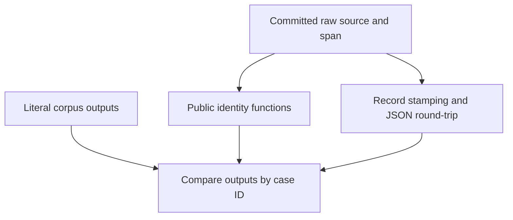

# Land shared shard consumer fixtures - Plan

## Goal Capsule

- **Objective:** Consumer developers can reuse the shared shard identity fixtures from PR #5 on the current codebase and verify proposition-to-shard joins.
- **Means:** Restore the supplied PR history and preserve the lane's newer conformance work (KTD1).
- **Authority:** Mandate item `foli-6`, the supplied drawdown standing rules, and the chief repository's `docs/plans/2026-10-26-0705-feat-codex-drawdown-campaign-plan.md` Goal Capsule and R11, R15, R16, R17, R19, R20. The authority-availability limitation is recorded below.
- **Execution profile:** One expansion, one branch, one controller-published PR. This stage commits only this plan on `drawdown/foli-6`; the later build runs `lfg` on it. The controller scans, pushes, and opens the PR; the campaign merge gate owns merging.
- **Stop conditions:** A missing PR object, an unresolvable contract conflict, or a required change outside R5 blocks the affected work. A build containing only planning or receipt documents cannot satisfy R1.

---

## Product Contract

### Summary

Restore PR #5's portable identity corpus, consumer tests, and reuse documentation from commit `8cf35db6898175590593ae8f81dffd40db5161ce`.
Verify the restored work against the lane's existing implementation, then hand off local commits for a PR superseding #5 and #8.

### Problem Frame

The README promises that a proposition and a shard from the same normalized source and span share an IRI.
This lane lacks PR #5's reusable corpus and fixture-backed join tests, although its Git object database contains the complete PR history.
The current checkout already contains newer conformance and lifecycle work that a restoration must preserve.

### Requirements

**Restore the consumer deliverable**

- R1. The completed branch must carry PR #5's fixture, test, and documentation changes in its diff against `main`.
- R2. Preserve the 29 literal identity cases, their eight original golden anchors, and the consumer join and validation tests.
- R3. Keep the frozen identity recipe and every pre-existing test intact; new repairs must retain or strengthen the restored coverage.
- R4. The focused fixture tests and full repository suite must pass in a fresh virtual environment installed with `.[dev,signing]`.

**Scope and delivery**

- R5. Work only on `foli-6`, with no spend, sends, credential access, security-setting changes, production data access, destructive deletion, or force-push. Schema migrations, data rewrites, package releases, new outside services, and deploy changes are outside this item.
- R6. Keep the branch `drawdown/foli-6` local and without a remote; publication belongs to the controller, and the new PR must explicitly supersede #5 and #8.
- R7. Describe verification truthfully: local corpus conformance does not establish execution inside folio-enrich or folio-insights.

### Key Decisions

- **Use the campaign merge gate for expansion delivery.** Governs R6. (session-settled: user-directed — chosen over holding expansions for personal review: the campaign authorizes merges behind its test and review guardrails.)

### Scope Boundaries

The restoration consists of these paths:

| Path | Restored content |
|---|---|
| `tests/fixtures/shared_shard_identity_v1.json` | Versioned, language-neutral corpus with literal expected outputs. |
| `tests/test_consumer_compatibility.py` | Corpus integrity, identity, stamping, and serialization tests. |
| `docs/consumer-compatibility.md` | Copying, checking, and diagnosing the fixture corpus. |
| `README.md` | Content-identity link to the consumer guide. |
| `docs/README.md` | Consumer guide index entry. |
| `docs/plans/2026-10-26-1318-feat-shared-shard-consumer-fixtures-plan.md` | Historical source plan carried by the requested commit range. |

The source PR has no runtime `src/` changes.
Its source deliverable is the fixture data and documentation backed by tests; R1 does not authorize inventing a runtime change.
Preserve `conformance/`, its generator, the current package version, dependency declarations, CI, and the existing runtime modules.

A runtime fixture loader, wheel distribution, generator consolidation, and new CI jobs are unnecessary for restoring the supplied work.
Reconsider them only under a separate mandate supported by consumer need.
There is no front-end change, so no Playwright screenshot is required.

#### Deferred to Follow-Up Work

Migration examples and general repository hygiene remain separate mandate items.
Execution of the corpus inside sibling repositories remains separate consumer work.

---

## Planning Contract

### Reverified Starting State

Static inspection on 2026-11-11 established the following:

| Evidence | Planning consequence |
|---|---|
| Clean `drawdown/foli-6` at `be8db76172f3e5a792bf19823b709db2a4512eea`; no remote configured | Preserve this supplied lane base and record the item-only delta from it. |
| Local `main` is `90f94bea43ce6f63176cd6271c7006c72f528dd3`, an ancestor of the lane base | A diff against local `main` also includes pre-existing v0.5.0 conformance/lifecycle work; do not attribute that work to this item. |
| PR head `8cf35db6898175590593ae8f81dffd40db5161ce` exists; its merge base with the lane is `be8db76172f3e5a792bf19823b709db2a4512eea` | The requested range is available without fetching or credentials. |
| That range contains four commits and adds six paths' content, with no deletions | A plan-only build or an unrelated code rewrite would fail the restoration requirement. |
| `tests/test_identity.py` retains eight three-value `GOLDEN` entries; the PR consumer test imports them | Preserve the anchor comparisons and verify collection in the build's fresh environment. |
| `README.md`, `docs/conformance.md`, and `tests/test_conformance.py` describe and check generated conformance assets | Keep those assets alongside the independently frozen consumer corpus. |
| `.github/workflows/ci.yml` checks Python 3.11–3.13 with pytest, Ruff, and mypy, plus a separate core-only import | Reuse these checks without changing the workflow. |

No repository or accessible ancestor `AGENTS.md`/`CLAUDE.md` was present.
The supplied instructions apply; `docs/handoffs/`, `.planning/`, and `docs/solutions/` were absent.
The existing `docs/plans/2026-10-09-ci-drain.md` supplies the established quality gates.

No tests, dependency installations, or project runtime probes were run during this planning stage.
Past CI failures are not a reproduced diagnosis; make any compatibility repair only after observing the failure during build.

### Authority Availability

The chief repository, its campaign plan, and `ops/drawdown/mandates/_common.md` were unavailable in this isolated lane.
The campaign Goal Capsule and cited R-IDs could not be independently read.
The supplied standing-rule restatement governs this plan pending the controller's comparison with those exact sections before build acceptance.
The historical PR plan records the same source-availability limitation.
This is a controller verification prerequisite, not a request for credentials or a user-only decision.

### Key Technical Decisions

- KTD1. **Apply the requested merge-base-to-PR-head cherry-pick range on the supplied lane.** The range currently contains `3dfcec0b9dd23d8d15b7ca93335d27ad7529f3a6`, `230fcff7c2ebfd470855db9ed998558326211d69`, `94d71919138aeb9eaac66674c345a7d260b21801`, and `8cf35db6898175590593ae8f81dffd40db5161ce`, in that order. Preserve the newer lane base when resolving conflicts. Resetting to the older local `main` would discard existing work.
- KTD2. **Keep independent expected values independent.** Preserve the literal consumer corpus separately from `conformance/identity-vectors.json`, which is generated from the implementation. Do not regenerate consumer expectations with the functions under test (R2, R3).
- KTD3. **Repair only demonstrated integration failures in the restored files.** The PR's cross-test import and fixture lookup require collection checks, but static inspection does not establish a failure. Keep existing assertions and parametrized cases when adjusting test plumbing (R3, R4).
- KTD4. **Compare both the item delta and the publication diff.** Use the recorded lane base for scope attribution and local `main` for R1. The controller must also compare against its actual publication base; this clone cannot establish the current remote tip.
- KTD5. **Preserve the campaign model choices.** Local work uses Astra; cloud build stages use the default Sol with Astra and Fable reviews. (session-settled: user-directed — chosen over the Sol-first local ladder and a forced cloud model: these choices are settled by the campaign.)

### Assumptions and Deferred Evidence

Commit-pinned repository reuse remains sufficient because it is the supplied PR's delivery contract.
Installing the wheel does not promise access to the JSON corpus.

The supplied lane tip is treated as the controller's intended current-code base.
Interpreter availability, dependency installation, test health, and any conflict introduced by subsequent repository movement remain build-stage observations.
If the controller's publication base has advanced, repeat integration verification on that resulting tree rather than using stale receipts.

### Contract Flow

`src/folio_propositions/identity.py` owns normalization and the frozen hash recipe.
`stamp_content_iris` copies records, stamps nonempty text, and preserves the existing validation and signed-history boundaries.

These tests make differences visible by case ID and output stage.
They provide local compatibility evidence under R7, without requiring sibling checkouts or services.

---

## Implementation Units

### U1. Restore the PR payload while retaining the lane base

**Goal:** Recover the complete consumer deliverable in the item branch.

**Requirements:** R1–R3, R5, R6. **Dependencies:** None.

**Files:** All six paths in Scope Boundaries; preserve this plan as the canonical `foli-6` execution contract.

**Approach:** Apply KTD1 after rechecking the worktree and source object.
Retain the historical plan as provenance without adopting its old branch, base, or execution instructions.
Resolve documentation overlaps by retaining current conformance/lifecycle content and adding the consumer entry points.
If repository movement makes a source commit empty, establish that its intended content already exists before skipping it.

**Test scenarios:**

1. Every corpus case yields its literal normalized source, normalized span, full hash, and IRI through the public API.
2. The original eight anchor IDs, raw inputs, and hashes remain unchanged.
3. Equivalent Unicode, newline, padding, and URI variants agree; significant source, span, path, query, fragment, and percent-escape differences remain distinct.
4. Unsupported fixture versions and malformed or duplicate cases fail with useful diagnostics.

**Verification:** The restored fixture and test module appear in both required diffs under KTD4.
The focused consumer tests pass under the Verification Contract.
This seam checks the published corpus and local API; it does not test another product's implementation.

### U2. Verify consumer joins and repair demonstrated incompatibilities

**Goal:** Preserve the PR's consumer behavior on the current implementation.

**Requirements:** R2–R5, R7. **Dependencies:** U1.

**Files:** `tests/test_consumer_compatibility.py`; read `tests/test_identity.py`, `tests/test_interchange.py`, and `tests/test_conformance.py` as regression anchors.

**Approach:** Follow KTD2 and KTD3.
Use the repository's existing public-model and parametrized-test patterns.
Observe the unmodified restored tests in a fresh environment before proposing repairs; retain any failing scenario as coverage.

**Test scenarios:**

1. Two propositions with different IDs, types, and asserters stamp to the same literal fixture IRI for one source/span and preserve it after JSON validation.
2. Extraction IDs, offsets, generator information, and document metadata do not affect the join key; stamping preserves raw fields, copies the record, and remains idempotent.
3. Changing the source or span produces the corresponding distinct fixture join key.
4. Missing or normalized-empty text remains unstamped; a missing source prevents stamping but may retain an unverified syntactically valid stamp.
5. An incorrect stamp is rejected when source and text are available, while existing signed-history protections continue to pass in the full suite.

**Verification:** Focused tests and the full suite pass in the fresh environment.
Any repair is limited to the restored change and retains all existing checks.
A baseline failure outside that boundary is reported with evidence and blocks the affected acceptance claim.

### U3. Restore accurate consumer guidance and delivery evidence

**Goal:** A developer can find, copy, and check the corpus with clear evidence limits.

**Requirements:** R1, R6, R7. **Dependencies:** U1, U2.

**Files:** `docs/consumer-compatibility.md`, `README.md`, `docs/README.md`.

**Approach:** Keep the PR's pinned-revision reuse instructions, versioned format, raw-input comparisons, mismatch reporting, and local-execution qualification.
Preserve current links to generated conformance assets.
Validate the reader example against the restored corpus and identify the source PR head in the controller handoff.

**Test expectation:** No additional prose-only unit test is needed.
Execute the documented reader, check its reported case count, and verify local links and named case IDs against the corpus.

**Verification:** The guide works without importing pytest internals and makes no wheel-distribution or live sibling-integration claim.
The controller handoff identifies the new PR as superseding #5 and #8.

---

## Verification Contract

All execution checks below belong to the build stage.
Create a fresh virtual environment, install editable `.[dev,signing]` using the existing development setup, and run checks with that environment's executables.
Use the supplied dependency cache without credential discovery.
Record interpreter and dependency versions alongside observed results.

| Check | Evidence | Required outcome |
|---|---|---|
| Baseline | Full suite, Ruff, and mypy before restoration | Record pre-existing failures separately. |
| Fresh focused run | `pytest -q tests/test_consumer_compatibility.py tests/test_identity.py tests/test_interchange.py` | Collection and every restored fixture/join case pass. |
| Full regression | `pytest -q` | All existing and restored tests pass, including lifecycle, models, and conformance. |
| Lint and types | `ruff check .`; `mypy src` | Existing quality gates pass. |
| Generated assets | `python scripts/generate_conformance.py --check` | Current conformance files remain synchronized without rewriting them. |
| Consumer instructions | Execute the guide's reader and inspect local links | All 29 committed cases match; referenced files and IDs exist. |
| Supported interpreters | Existing Python 3.11–3.13 CI commands, locally where available and on controller publication | Report each actual result; never infer matrix success from one interpreter. |
| Core-only import | Existing isolated-import CI check in a separate core-only environment | Package imports with `cryptography` absent. |
| Scope and substance | Item-base delta plus diff against `main`, followed by controller publication-base comparison | Fixture, test, and guide changes are present; newer base work remains intact. |

The later build includes simplification and review through `lfg`, followed by local commits.
No push or PR creation is performed from the lane.
Any unavailable check remains explicit in the handoff and cannot be represented as passing.

---

## Definition of Done

- R1–R4 hold with the restored source payload present; a plan or receipt alone is insufficient.
- U1–U3 preserve the PR's intent and the lane's existing conformance and lifecycle behavior.
- The Verification Contract has passing execution evidence for focused tests, the full suite, and required quality gates.
- No abandoned helper or experimental code remains in the item diff.
- The controller has checked the unavailable campaign authority sections before accepting the build.
- Local commits are ready for controller publication on `drawdown/foli-6`, with the handoff stating that the new PR supersedes #5 and #8.
