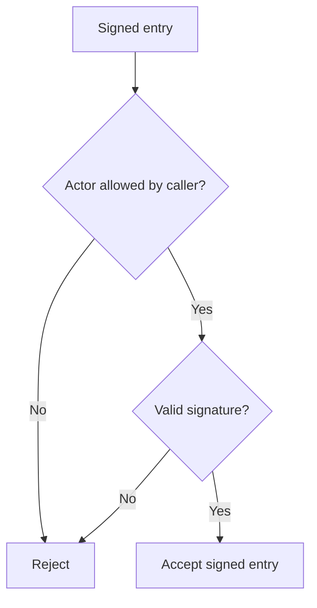
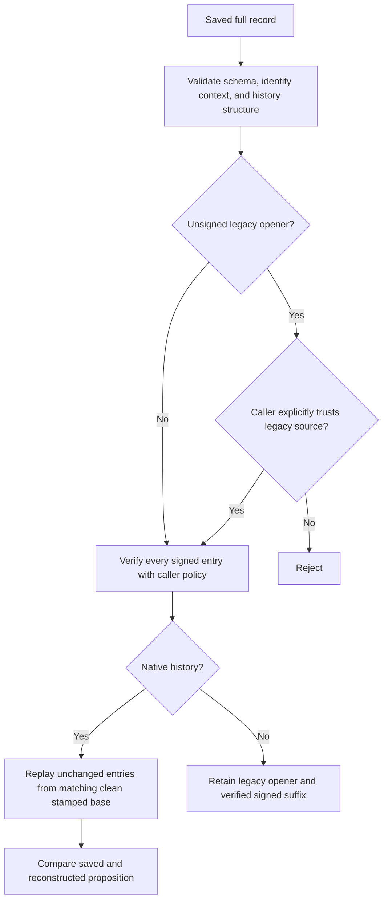
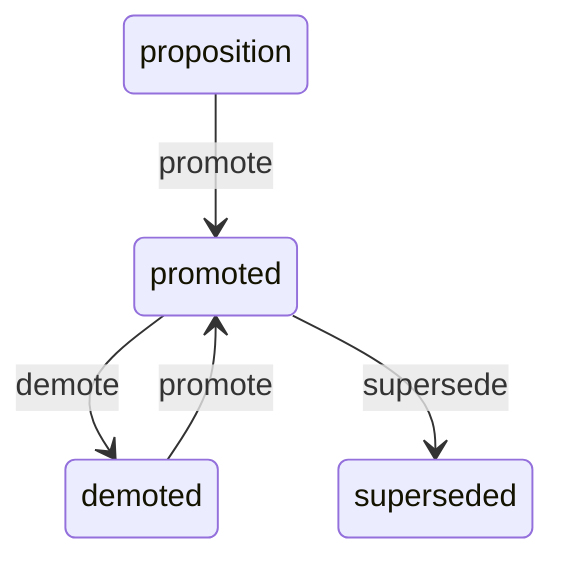

# Land Authorized Signer and Lifecycle Migration Examples - Plan

## Goal Capsule

- **Objective:** Developers using the current package can run the authorized-signer and lifecycle migration examples from PR #6 and see the difference between verified signed history and explicitly trusted legacy status.
- **Means:** Restore the supplied PR history, preserve the current checkout, and verify the restored examples with their tests (KTD1–KTD4).
- **Authority:** The `foli-7` mandate and supplied standing lane rules govern this item. The chief repository's `docs/plans/2026-10-26-0705-feat-codex-drawdown-campaign-plan.md`, Goal Capsule and campaign R11, R15, R16, R17, R19, R20, is the named campaign authority; its availability limitation is A1.
- **Execution profile:** One branch, `drawdown/foli-7`, and one replacement PR. This stage commits only this plan. The later build invokes `lfg` on this plan for implementation, simplification, review, verification, and local commits. The controller pushes and opens the replacement PR; the campaign merge gate merges it.
- **Stop conditions:** If the supplied source commit is unavailable at build start, stop and report it under `## Needs your decision`. Never publish a completed-item branch containing only plans or receipts. Apply the campaign's held-change and blocker reporting rules if an essential dependency exceeds R7.

---

## Product Contract

### Summary

Land PR #6's complete migration walkthrough and tests on the supplied checkout.
Resolve overlap with the newer README while retaining the current package's v0.5.0 behavior, then provide fresh verification evidence for a PR superseding #6 and #9.

### Problem Frame

The supplied checkout has the v0.5.0 package and lifecycle documentation but lacks PR #6's runnable consumer example and integration tests.
The original PR head is available locally, so its implementation can be recovered without recreating the feature.
Its historical test receipt does not prove compatibility with this checkout or the supported CI environments.

### Requirements

**Recovered consumer behavior**

- R1. Restore the PR's commits through `37ad3b828b0112ac52366985f3fcb590b989ecf4`; the final diff must contain its example source and tests, preserving both demonstrations.
- R2. Preserve caller-owned signer authorization together with signature verification for new transitions and every saved signed entry, including native lifecycle reconstruction from the original recorded transitions.
- R3. Preserve default rejection of an unsigned legacy migration opener and explicit caller-owned opt-in, while requiring authorization and valid signatures for every later signed entry.

**Compatibility and delivery**

- R4. Retain the current checkout's behavior and documentation, and never delete or weaken an existing or restored test (campaign R15, R16).
- R5. Each migration example must have a passing test, and the current full suite must pass with fresh build evidence.
- R6. Keep this item on `drawdown/foli-7`, commit locally, and hand publication to the controller with the explicit statement that the new PR supersedes #6 and #9 (campaign R17, R19).
- R7. Keep the work within the supplied safety boundaries: no spend, sends, production data or credential access, security-setting changes, unbacked deletion, force-push, added remote, or credential discovery; add no schema migration, data rewrite, package release, outside service, or deployment configuration (campaign R11, R15, R16, R20).

### Acceptance Examples

- AE1. The native demonstration completes `proposition → promoted → demoted → promoted → superseded`, reloads under caller policy, and reconstructs equal state and history from unchanged signed entries. A valid but unauthorized signer and an obsolete demotion are refused. Covers R1, R2.
- AE2. The legacy demonstration retains the unsigned sequence-zero `migrate` opener. Loading rejects it by default before and after a signed append; explicit legacy trust permits the opener but does not permit an unauthorized or tampered signed suffix. Covers R1, R3.
- AE3. A developer follows the current README into the migration guide and runs the checkout script successfully; both demonstrations print the documented outcomes without key or signature material. Covers R1–R5.

### Scope Boundaries

The restoration consists of the six original PR paths listed below, this plan, and a fresh `docs/plans/evidence/foli-7-verification.md` receipt.
Limit compatibility repairs to those restored paths unless a concrete regression proves that the stated scope cannot work; report such a conflict instead of broadening the item silently.
Package source, schemas, dependency declarations, CI, and deployment configuration are outside the expected change.
This example uses the library's existing in-memory migration; it does not migrate stored data.

No front-end change is planned, so a Playwright screenshot is not applicable.
If an essential front-end change emerges, the campaign's committed screenshot and `SCREENSHOT:` reporting requirements still apply.

Historical authorization services, revocation, generic ingestion, trusted history checkpoints, and new reject/override walkthroughs are not part of restoring these examples.
The existing guide limits acceptance to the presented history under current policy and explains optional source/text limitations.
A new consumer guarantee would require separate scope.
Shared-shard fixtures and general coverage, CI, or audit work remain assigned to other mandate items.

---

## Planning Contract

### Verified Starting State

Static inspection on 2026-11-11 found a clean `drawdown/foli-7` at `be8db76172f3e5a792bf19823b709db2a4512eea`.
The local `main` ref remains at `90f94bea43ce6f63176cd6271c7006c72f528dd3`, an ancestor of the supplied checkout and the merge base with the source PR.
No remote is configured.
No repository `AGENTS.md`, `CLAUDE.md`, `docs/handoffs/`, `.planning/`, or matching current plan was found; `docs/plans/2026-10-09-ci-drain.md` documents the existing checks.
No tests, examples, builds, or dependency installations ran during this planning stage.

The source head exists and has these five commits beyond the merge base, in application order:

| Commit | Original contribution |
| --- | --- |
| `53a5970199237406c7647f20ff9d5577347069bd` | Original `foli-2` plan. |
| `c7576b762f27a26054b1378eb68515d1c9498e34` | Authorized native lifecycle and replay example. |
| `366df2e45232046d44e276fde70f86f200cacb1d` | Explicit trust for legacy lifecycle anchors. |
| `00637b8b0ff5e2af6886428c77b561b259775a1f` | Runnable migration documentation and README link. |
| `37ad3b828b0112ac52366985f3fcb590b989ecf4` | Historical verification receipt. |

The complete original change touches:

- `examples/migration_v4.py`.
- `tests/test_migration_examples.py`.
- `docs/migration-0.4.0.md`.
- `README.md`.
- `docs/plans/2026-10-26-1342-feat-foli-2-migration-examples-plan.md`.
- `docs/plans/evidence/foli-2-verification.md`.

The example and test file are absent from the starting checkout.
The PR test file has 13 test functions expanding to 19 cases, including direct tests of `native_demo`, `legacy_demo`, and the script entry point.
These counts describe source inventory, not an executed result.

### Assumptions and Deferred Execution Facts

- A1. The chief campaign plan and `ops/drawdown/mandates/_common.md` are unavailable in the supplied sandbox. Campaign R-ID references trace to the user's supplied rules, not independently read excerpts. The controller must reconcile the named Goal Capsule and R-IDs before the build handoff; this is an input-availability limitation, not a product decision.
- A2. The controller intentionally supplied the newer branch tip as the landing baseline. Preserve it rather than resetting to the stale local `main`; the controller reconciles its actual publication target before opening the PR.
- A3. No runtime or Python-version incompatibility is established by static inspection. Exact cherry-pick conflicts, dependency availability, and test outcomes belong to the build stage.

### Key Technical Decisions

- KTD1. **Restore history onto the supplied branch.** Use the mandate's merge-base-to-source-head cherry-pick range, retaining the five source commits' intent. Record the build starting tip separately from the eventual verification commit. Inspect the final diff against both `main` and the frozen starting tip so existing v0.5.0 work cannot satisfy R1 by itself.
- KTD2. **Resolve README overlap additively.** Keep the current normative-shape description, reject/override semantics, both migration links, conformance section, and generator check; insert the PR's consumer-example link beside the lifecycle guidance. The source PR overlaps the lifecycle paragraph, while `docs/migration-0.4.0.md` is unchanged between the merge base and the supplied checkout. Follows R1, R4.
- KTD3. **Reuse the existing trust and replay implementation.** The v0.5.0 core retains schema and signing-payload version 4 and the default lifecycle actions used by the example. Preserve `AuthorizedVerifier`, full-record validation before history verification, native reconstruction from unchanged events, and the separate legacy path. Existing `tests/test_lifecycle.py` protects reject/override; this item does not require another tutorial. Follows R2–R4.
- KTD4. **Prove installation and console-test parity.** Use a fresh virtual environment installed from this checkout with `.[dev,signing]` and the actual CI console `pytest` entry point. The tests load the example by file path, but their subprocess needs the package installed in its interpreter; pytest's configured `src` path alone is insufficient. Do not substitute a different launcher, skip the subprocess test, or guess a packaging fix without a reproduced failure. Follows R4, R5.
- KTD5. **Separate historical and current evidence.** Retain the imported `foli-2` receipt as history and write a new receipt for this landing. Reproduce any baseline failure before labeling it pre-existing; historical test counts, lint exceptions, or review conclusions do not establish R5.
- KTD6. **Retain the campaign execution split.** Local work uses Astra; cloud builds use default Sol and retain the controller's Astra/Fable review gates (session-settled: user-directed — chosen over the Sol-first local ladder and carrying the local model choice into cloud builds: the campaign assigns distinct execution environments). Follows R6.
- KTD7. **Deliver through the guarded campaign.** Publication stays with the controller and campaign merge gate (session-settled: user-directed — chosen over holding expansions for routine user review: expansions merge after their guardrails pass). Autonomous work does not wait on routine approval, and exhausted mandate work leads to durable hygiene rather than speculative features. Follows R6, R7.

### Trust and Replay Shape

The restored example uses the same authorization boundary for append and saved-history verification (R2, R3; KTD3):

The walkthroughs share validation and verification but retain distinct reconstruction rules (AE1, AE2):

The native route covers four signed transitions; the legacy opener is never submitted to native reconstruction:

### Research Anchors

`src/folio_propositions/lifecycle.py` separates append legality from saved-history signature verification.
`src/folio_propositions/models.py` and `src/folio_propositions/interchange.py` validate history structure and source/span consistency.
`src/folio_propositions/signing.py` retains the example's public signing helpers and optional cryptography boundary.
`tests/test_lifecycle.py`, `tests/test_interchange.py`, and the source PR's example tests provide the existing coverage patterns.
Local history and these direct implementations settle the restoration approach; no new architecture or external dependency is selected.

---

## Implementation Units

### U1. Restore the complete PR on the supplied baseline

**Goal:** Recover the actual examples, tests, documentation, and provenance required by R1.

**Requirements:** R1, R4, R6, R7; KTD1, KTD2, KTD5–KTD7.

**Dependencies:** Recheck branch cleanliness, source-head availability, and baseline identity; establish the build's pre-change checks.

**Files:** Restore the six original PR paths listed in Verified Starting State, including `tests/test_migration_examples.py`.

**Approach:** Apply the mandate's complete commit range to the existing branch. Resolve conflicts using KTD2, retain source/test changes, and keep this `foli-7` plan as the current landing contract alongside the historical `foli-2` plan.

**Execution note:** Capture the baseline before applying the PR; preserve unrelated work and all original test cases.

**Test scenarios:**

1. Restored tests collect in the fresh installed environment and exercise the actual example file.
2. Both the frozen-start and `main` comparisons contain `examples/migration_v4.py` and `tests/test_migration_examples.py`, not just documentation.
3. README retains the current v0.5.0 material and resolves the consumer-example link to the restored guide.

**Verification:** All five source contributions are accounted for, with no loss of current checkout behavior or existing tests. Static file/diff inspection establishes restoration; runtime acceptance belongs to U2 and U3.

### U2. Establish native and legacy example compatibility

**Goal:** Keep the restored consumer behaviors correct on the current library.

**Requirements:** R2–R5, R7; AE1–AE3; KTD3, KTD4.

**Dependencies:** U1.

**Files:** `examples/migration_v4.py`, `tests/test_migration_examples.py`, `docs/migration-0.4.0.md`; inspect `tests/test_lifecycle.py` and `tests/test_interchange.py` without weakening them.

**Approach:** Exercise the restored helpers first. Make only repairs supported by observed failures, with a focused regression test for any behavior changed beyond the imported coverage.
The existing integration seam proves real signatures and script execution; it does not prove historical authorization or completeness of an omitted history suffix.

**Test scenarios:**

1. Covers AE1. Preserve `test_native_walkthrough_replays_unchanged_signed_entries`, including final state, identity, sequence, history equality, and reuse of the recorded entries.
2. Preserve migration and append immutability, empty and copied allowlists, unauthorized earlier actors, and rejection of valid-but-unauthorized or tampered signatures during append and reload.
3. Preserve validation failures for changed source, text, sequence, final status, and signed timestamps, plus stale-event and cross-identity replay rejection.
4. Covers AE2. Preserve `test_legacy_walkthrough_retains_unsigned_anchor`, default rejection before and after signed append, explicit opt-in, suffix signature/authorization checks, and malformed legacy-entry rejection.
5. Covers AE3. Preserve `test_checkout_script_entry_point`: successful exit, empty stderr, and all seven documented output lines.

**Verification:** All restored cases pass against the shipped helpers. Current lifecycle and interchange suites pass unchanged; no speculative library, packaging, or CI edits are needed merely to declare compatibility.

### U3. Record fresh proof and prepare controller delivery

**Goal:** Supply current acceptance evidence for the replacement PR.

**Requirements:** R1, R4–R7; AE3; KTD1, KTD4–KTD7.

**Dependencies:** U1, U2.

**Files:** Create `docs/plans/evidence/foli-7-verification.md`; verify the README, migration guide, example, and `tests/test_migration_examples.py` together.

**Approach:** Run the Verification Contract, record the exact checked code commit and interpreter/tool versions, and distinguish passed checks from unresolved failures or unavailable environments. Keep the imported receipt unchanged as historical evidence.

**Test expectation:** No new behavior is introduced by the receipt; it reports the actual U2 tests and complete repository checks.

**Verification:** The local source-bearing branch, scoped diff, plan path, and fresh evidence are ready for controller publication. The final build report says the new PR supersedes #6 and #9.

---

## Verification Contract

Run these checks only in the build stage, using the repository's existing development and signing extras.
Establish the pre-change baseline before restoring the PR, then verify the final code commit.
Use cached dependencies where needed; unavailable infrastructure is a reported limitation, not permission to weaken a check.

| Check | Acceptance evidence |
| --- | --- |
| `pytest -q tests/test_migration_examples.py` | All restored example cases pass, including both direct demonstrations and the subprocess entry point. |
| `pytest -q tests/test_migration_examples.py tests/test_lifecycle.py tests/test_interchange.py` | Restored examples and current migration/lifecycle contracts pass together. |
| `pytest -q` | Full suite passes using the console entry point from `.github/workflows/ci.yml`. |
| Python 3.11, 3.12, 3.13 | Exercise the CI checks in fresh installed environments on supported interpreters; identify any unavailable local version for controller CI verification. Never claim a missing run passed. |
| `ruff check .` | Repository lint passes; any failure has current baseline evidence and a reported disposition. |
| `mypy src examples/migration_v4.py` | Existing source checks and the restored example's explicit type check pass. |
| `python scripts/generate_conformance.py --check` | Existing v0.5.0 conformance artifacts still match the implementation. |
| Documented script and signing fragment | Run from the checkout with the installed package; both demonstrations and the authorized-signing snippet succeed as documented. |
| Core-only isolated import from `.github/workflows/ci.yml` | A separate core-only environment imports the package without cryptography. |
| Source and documentation audit | Both comparison bases carry the example and tests, links resolve, no existing test is weakened, and only scoped/public-safe changes are included. |

The final receipt identifies the frozen baseline, source head, checked code commit, commands, outcomes, and review coverage.
Do not reuse the old receipt's 137-test result or historical lint exception as current evidence.
Controller CI and campaign reviews remain required before merge; a failing or unavailable required check prevents an unqualified completion claim.

---

## Definition of Done

- U1 restores all source PR contributions and preserves the newer checkout; both required diff comparisons demonstrate actual example and test delivery.
- U2 proves AE1–AE3 without removing or weakening restored or pre-existing tests.
- U3 provides fresh full-suite and required-check results, with explicit dispositions for any environment limits; old receipts are not acceptance evidence.
- The reviewed diff contains no abandoned implementation attempts, unrelated changes, secret material, or forbidden operations under R7.
- The build is simplified, reviewed, and committed locally on `drawdown/foli-7`; the controller receives the plan and evidence paths.
- The replacement PR is described as superseding #6 and #9. The plan-only commit from this stage is not the completed landing.
- No user decision or held change is currently identified. Newly discovered blockers use the campaign's `## Needs your decision` format; essential held changes use `## Held change` with the reason.
