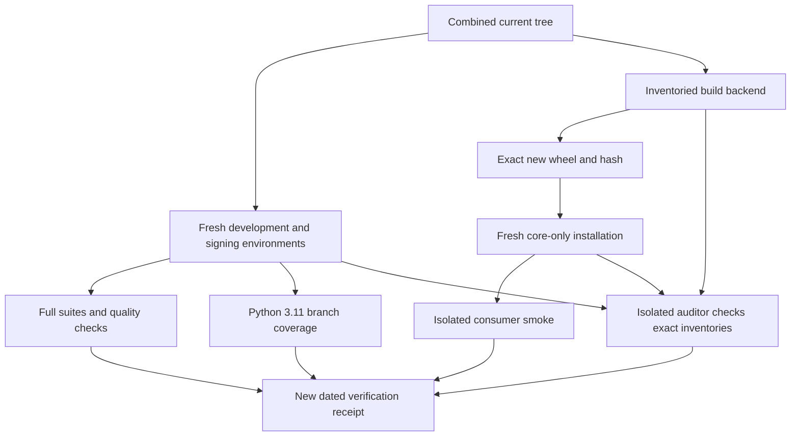

# Land Maintenance Assurance - Plan

## Goal Capsule

- **Objective:** Maintainers can verify that current consumer workflows work from both the checkout and an installed package, with repeatable coverage and dependency-audit evidence.
- **Means:** Restore PR #10's maintenance work onto the supplied current-code lane and reconcile its older-version assumptions (KTD1–KTD4).
- **Authority:** Mandate item `foli-8`, the supplied drawdown standing rules, and the chief repository's `docs/plans/2026-10-26-0705-feat-codex-drawdown-campaign-plan.md`, limited to its Goal Capsule and R11, R15, R16, R17, R19, R20. Campaign IDs are separate from this plan's requirements. See Authority Availability.
- **Execution profile:** One hygiene item on `drawdown/foli-8`, delivered as one controller-published replacement PR. This stage commits only this plan; the later build uses `lfg` for implementation, simplification, review, verification, and local commits. The controller scans, pushes, and opens the PR; the campaign gate owns merging.
- **Stop conditions:** A missing source commit, unresolved conflict with R2 or R6, or incomplete required verification prevents the affected acceptance claim. A completed build must contain the substantive PR payload under R1; planning and receipt documents alone do not satisfy the item.

---

## Product Contract

### Summary

Restore PR #10's regression tests, installed-wheel smoke, dependency auditor, coverage and CI checks, and maintenance documentation from `a714cb1708d5bfa74bd68841ef9ffd3a6ba68eb4`.
Verify the combined current tree and prepare local commits for a replacement PR that supersedes #10.

### Problem Frame

The lane already contains newer lifecycle, conformance, and shared-shard consumer work, but lacks PR #10's maintenance tooling and additional tests.
That PR was built against package 0.4.0; the supplied lane is 0.5.0, and one accepted-wheel test fixture still names the older release.
Its historical verification cannot establish that the combined tree passes or that today's dependency resolutions have been audited.

### Requirements

**Restore and preserve**

- R1. The completed branch's diff against `main` must contain PR #10's substantive source and test changes, restored from the supplied commit history.
- R2. Preserve existing runtime behavior, package version 0.5.0, schema and signing-payload version 4, generated conformance assets, consumer fixtures, and every existing test and assertion.
- R3. The restored tests and the complete repository suite must pass; retain the full Python 3.11–3.13 pytest, Ruff, and mypy checks.

**Maintenance evidence**

- R4. Restore the PR's coverage, installed-wheel, and dependency-audit gates with passing evidence from the combined tree; preserve failures for incomplete or adverse audit results.
- R5. Documentation must describe current behavior and reproducible checks, distinguishing new verification from historical PR receipts and from controller-owned hosted checks.

**Scope and delivery**

- R6. Work only `foli-8`: no spend, sends, production-data access, credential access, security-setting changes, deploy-configuration changes, destructive deletion, or force-push. Add no schema migration, data rewrite, package release, or new outside service.
- R7. Keep local commits on `drawdown/foli-8` without adding a remote or seeking credentials; the controller's new PR must state that it supersedes #10.

### Key Decisions

- **Complete durable hygiene within the mandate.** Governs R1–R6. (session-settled: user-directed — chosen over speculative features once planned work and worthwhile expansions run out: complete useful maintenance work.)
- **Use the campaign review and merge gate.** Governs R7. (session-settled: user-directed — chosen over holding guarded changes for personal approval: the controller and campaign gate own publication and acceptance.)

### Scope Boundaries

The source range touches these paths; the lifecycle test's redundant-comment removal is already present on the supplied lane.

| Paths | Restoration intent |
|---|---|
| `tests/test_interchange.py`, `tests/test_signing.py` | Migration dispatch, copy ownership, signing-input boundaries, and positive controls. |
| `tests/core_smoke.py` | Core consumer behavior from a non-editable wheel without the signing extra. |
| `scripts/audit-dependencies.sh`, `tests/test_dependency_audit.py` | Exact dependency inventories, restricted local origins, and complete-result audit checks. |
| `.github/workflows/ci.yml`, `pyproject.toml`, `.gitignore` | Existing CI matrix plus coverage, wheel verification, audits, and disposable-output ignores. |
| `README.md`, `docs/README.md` | Accurate lifecycle limits and maintenance instructions. |
| `tests/test_lifecycle.py` | Preserve the lane's full current file; the source PR adds no behavioral assertion here. |
| `docs/plans/2026-10-26-1419-chore-foli-3-maintenance-assurance-plan.md` | Historical source-plan provenance. |
| `docs/plans/evidence/foli-3-verification.md`, `docs/plans/evidence/foli-3-audit.md` | Dated historical receipts, retained as historical evidence. |

The source PR has no runtime `src/folio_propositions/` change.
Its executable source deliverable includes the audit script and CI/tooling changes; R1 does not require inventing a runtime patch.
A new `docs/plans/evidence/2026-11-11-foli-8-verification.md` will record build evidence.
Additions to existing test modules are allowed only for demonstrated integration or coverage gaps under KTD4; keep all existing tests intact.

There is no frontend change, so no Playwright screenshot applies.
The restored local wheel build is a verification artifact, not a package release.
The existing PyPI advisory query is part of the supplied PR; no additional service is proposed.

#### Deferred to Follow-Up Work

Migration-example restoration belongs to `foli-7`.
New runtime features, changes to signer authorization policy, and sibling-repository integration remain outside this item.
A new audit framework, lockfile policy, or hosted coverage service is unnecessary for the supplied restoration; reconsider only under a separate maintenance need.

---

## Planning Contract

### Reverified Starting State

Static inspection on 2026-11-11 established the following; no tests, installations, builds, runtime probes, or audits ran during planning.

| Evidence | Consequence |
|---|---|
| Clean `drawdown/foli-8` at `6729ace779b610b8c4081990e496dfdc56b48073`; no remote | Retain this supplied lane base and record the item delta from it. |
| Local `main` is `90f94bea43ce6f63176cd6271c7006c72f528dd3`, an ancestor of the lane | Its diff includes pre-existing newer work; it is not proof of the controller's current publication base. |
| PR head `a714cb1708d5bfa74bd68841ef9ffd3a6ba68eb4` exists; merge base with the lane is local `main` | All five requested source commits are available without fetching. |
| Current package is 0.5.0; schema and signing-payload versions remain 4 | Update package-origin fixtures without rewriting schema/signing oracles. |
| Current dev extras contain `jsonschema>=4.23`; the PR adds `coverage>=7.6` | Merge the extras rather than replacing either list. |
| PR audit tests accept a 0.4.0 wheel, but the script derives the allowed wheel from package metadata | Repair the stale fixture without broadening accepted origins. |
| Current workflow equals the source merge-base workflow | Restore the maintenance jobs while retaining existing matrix, permissions, action refs, cancellation, and timeouts. |
| PR interchange/signing tests target runtime modules unchanged since the merge base | Preserve their assertions and observe execution before any further compatibility repair. |

No repository or accessible ancestor `AGENTS.md`/`CLAUDE.md` was present.
The supplied instructions apply; `docs/handoffs/`, `.planning/`, and `docs/solutions/` were absent.
Existing CI and consumer-landing plans document the established checks; their earlier passing receipts are not fresh verification.

### Authority Availability

The chief repository, campaign plan, and `ops/drawdown/mandates/_common.md` were unavailable in this isolated lane.
The campaign Goal Capsule and cited R-ID text could not be independently read.
The supplied standing rules govern this plan pending the controller's comparison with those exact sections before build acceptance.
This is a controller verification prerequisite, not a request for credentials or a user-only decision.

### Key Technical Decisions

- KTD1. **Cherry-pick the complete requested source range onto the supplied lane.** The merge-base-to-PR-head range contains `5e2c12c02d13fa246e844ef464d6d546c9801632`, `2e2989282c24bbd1be28ccf99789759b10270801`, `c5cf3e7e7c48c076a7e99cfa3ade60684d765ef2`, `c5207615b5302e10ee461442b47d572170c129de`, and `a714cb1708d5bfa74bd68841ef9ffd3a6ba68eb4`, in that order. Resetting to the older local `main` would discard newer work. Retain this plan as the canonical `foli-8` contract rather than adopting the historical plan's branch or starting-state instructions (R1, R2).
- KTD2. **Resolve overlaps by preserving the current base plus PR intent.** Keep both development dependencies, current lifecycle `reject`/`override` guidance, normative-shape documentation, conformance checks, and shared-shard links. Compare any empty cherry-pick's intended payload with the actual tree before skipping it; neither commit count nor a clean tree proves restoration (R1, R2).
- KTD3. **Make accepted-wheel test data follow current project metadata.** Preserve the exact-origin rule in the auditor, retain editable/no-local-package success cases, and add a stale or wrong-version wheel rejection case. Keep literal schema/signing version 4 expectations and the independent signing-payload oracle in `tests/core_smoke.py` (R2–R4).
- KTD4. **Retain the source PR's verification strength.** Keep branch coverage over all package modules on Python 3.11 with the 97% combined floor, plus the full suites on 3.12 and 3.13. If the combined tree exposes a gap, add meaningful targeted tests; do not lower the threshold, add exclusions, skip tests, or reduce collection. Measure before and after restoration using comparable settings and dependency resolutions (R2–R4).
- KTD5. **Bind package and audit evidence to what was actually tested.** Use a fresh verification copy of the complete combined tracked tree, with its own initially empty `dist/`, preserving all pre-existing lane artifacts. Build the current-version wheel there using an inventoried backend, install that exact wheel into a separate core-only environment, and record its hash. Run audits from that same verification root: the restored script accepts local wheel origins only at its root's exact current-version `dist` path. Development editable installs must also reference that root. Audit each development/signing environment, the actual backend, and the installed core environment with the restored isolated auditor; retain its existing interface and origin restrictions. Synthetic offline tests do not substitute for live advisory results (R4, R6).
- KTD6. **Record separate scope and acceptance comparisons.** Compare the item delta with the recorded lane base and the substantive branch diff with local `main`; the controller must also compare its real publication base and repeat integration checks when the resulting tree changes (R1, R7).
- KTD7. **Preserve campaign model routing.** Local work uses Astra, while cloud build stages use default Sol and retain Astra/Fable PR reviews. (session-settled: user-directed — chosen over the Sol-first local ladder and a forced cloud model: retain the campaign's model choices.) Local plan review does not replace those later PR gates (R7).

### Assumptions and Deferred Evidence

The supplied lane tip is treated as the controller's intended current-code base because local `main` is older and this clone has no remote.
Interpreter availability, exact dependency resolutions, measured coverage, advisory results, and additional integration failures remain build-stage observations.
Public package metadata and the PR's existing advisory endpoint are expected to be usable without accounts; unavailable checks remain incomplete and are reported to the controller.

### High-Level Technical Design

The restoration retains the source PR's separate development, backend, core-wheel, and auditor environments.
The evidence flow makes installed-package behavior and dependency results attributable to the same tested tree.

---

## Implementation Units

### U1. Restore all five source commits without losing current work

**Goal:** Put the complete maintenance payload onto the item branch.

**Requirements:** R1, R2, R6, R7. **Dependencies:** Build intake and baseline verification.

**Files:** The restoration paths listed in Scope Boundaries; this plan remains the execution contract.

**Approach:** Apply KTD1 and KTD2 after rechecking the branch, source object, and working tree.
Preserve unrelated work and resolve each conflict against the recorded base and source intent.
Keep historical plans and receipts as provenance.

**Test expectation:** No new restoration-only unit test; the substantive checks are owned by U2 and U3.

**Verification:** All source payloads are accounted for, including any empty-commit disposition.
Both KTD6 comparisons contain executable maintenance tooling and restored tests; current runtime, conformance assets, consumer fixtures, and existing assertions remain intact.

### U2. Reconcile and verify consumer, signing, and audit tests

**Goal:** The restored tests exercise the current package without weakening their contracts.

**Requirements:** R2–R4, R6. **Dependencies:** U1.

**Files:** `tests/test_dependency_audit.py`, `tests/test_interchange.py`, `tests/test_signing.py`, `tests/core_smoke.py`; existing test modules only for demonstrated coverage gaps under KTD4.

**Approach:** Apply KTD3, using the existing pytest parametrization, monkeypatch restoration, and standard-library smoke patterns.
Observe the restored tests before repairing additional failures.
Audit tests exercise the real Bash script with fake tools and no network; installed-wheel smoke and live audits remain separate proof in U3.

**Test scenarios:**

1. The exact current-version wheel and recognized editable origin are accepted; a stale wheel and unexpected URL/editable origin are rejected before the auditor is invoked.
2. Missing, duplicate, skipped, vulnerable, malformed, or version-mismatched audit reports fail; a nonzero auditor exit remains a failure despite clean-looking JSON.
3. Migration downgrade and missing-step errors preserve input; no-op migration returns independently mutable nested data, and temporary callback registration is restored after use.
4. Invalid record versions retain their current errors, while historical missing child versions follow the existing migration behavior.
5. Wrong DID codec/key lengths and malformed signatures are rejected, paired with a successful real signature as a positive control.
6. Core-wheel smoke preserves literal schema/signing expectations, JSON round trips, identity stamping, accepting/rejecting verifier behavior, and ordered replay of every signed history entry.

**Verification:** Focused restored tests and the full suite pass under the Verification Contract.
Any added coverage asserts an actual public outcome; original assertions remain active.
The synthetic smoke verifier proves protocol behavior, not cryptographic validity or authorization policy.

### U3. Verify restored CI, coverage, wheel, and audit gates

**Goal:** Maintainers can reproduce the restored checks on the combined tree.

**Requirements:** R2–R4, R6. **Dependencies:** U1, U2.

**Files:** `.github/workflows/ci.yml`, `pyproject.toml`, `.gitignore`, `scripts/audit-dependencies.sh`, `tests/test_dependency_audit.py`, `tests/core_smoke.py`.

**Approach:** Follow KTD4 and KTD5; retain the source workflow's existing security posture and bounded jobs.
Keep raw freezes, reports, and temporary environments untracked, with sanitized public dependency inventories in the receipt.
An unreachable service or unavailable interpreter is an evidence gap, never a successful gate.

**Test scenarios:**

1. All supported interpreter legs collect the complete suite and retain Ruff/mypy; Python 3.11 measures every package module and meets the restored floor.
2. A deliberately higher coverage threshold fails without changing tests or configuration.
3. Isolated smoke accepts the freshly built non-editable wheel with `py.typed` and no cryptography; editable and signing-enabled environments fail its provenance/isolation checks.
4. Backend inventories match before and after the build; the recorded wheel hash identifies the artifact installed into the audited core environment.
5. Audits of all five environments require complete matching reports and successful exit codes; a real collection-failure control remains nonzero.
6. Workflow syntax and embedded shell parse, the preserved matrix and permissions remain intact, and no `continue-on-error` or shell fallthrough hides failures.

**Verification:** The concrete checks below pass with recorded interpreter, tool, and dependency versions.
Fresh live results are distinct from offline audit-fixture tests and historical receipts.

### U4. Reconcile documentation and record the replacement handoff

**Goal:** Developers can follow current maintenance instructions and assess exactly what was verified.

**Requirements:** R1, R5–R7. **Dependencies:** U1–U3.

**Files:** `README.md`, `docs/README.md`, `docs/plans/evidence/2026-11-11-foli-8-verification.md`; retain the three historical plan/receipt files from the source range.

**Approach:** Preserve current lifecycle and conformance guidance while applying the PR's distinction between mutable models, structural validation, signature verification, and caller authorization.
Make local wheel instructions use KTD5's fresh verification root and exact artifact, so build, install, and audit agree on the wheel origin.
Label historical receipts as dated source-PR evidence and link the new receipt separately.

**Test expectation:** No prose-only unit tests; execute the documented maintenance commands during build and check links, exports, and claims against the final tree.

**Verification:** The new receipt identifies the source and lane commits, conflict dispositions, tested tree, actual results, coverage, exact public dependency inventories, and wheel hash.
It records unavailable checks without passing claims and states that the controller's new PR supersedes #10.
The build completes its simplification and review under KTD7, then leaves local commits for controller publication.

---

## Verification Contract

All commands in this section belong to the build stage.
Recheck the starting tree and create fresh development environments installed with `.[dev,signing]`, using the supplied dependency cache.
Record baseline results before restoration and distinguish pre-existing failures from regressions.
Run commands through the intended environment's executables.

| Check | Command or evidence | Required outcome |
|---|---|---|
| Baseline | `pytest -q`, `ruff check .`, `mypy src`; comparable branch-coverage measurement | Actual starting results recorded without assuming the earlier receipts still apply. |
| Restored regression tests | `pytest -q tests/test_interchange.py tests/test_signing.py tests/test_dependency_audit.py` | All restored and repaired cases pass. |
| Full supported suites | `pytest -q`, `ruff check .`, `mypy src` on Python 3.11, 3.12, 3.13 | Complete existing and restored suites pass on every available leg; missing legs remain explicitly pending. |
| CI coverage leg | `coverage run -m pytest -q`, `coverage report`, `coverage json` on 3.11 | Full-suite statement/branch evidence meets KTD4; retain the higher-threshold failure control. |
| Existing generated assets | `python scripts/generate_conformance.py --check` plus full conformance and consumer tests | Generated assets remain synchronized and literal consumer oracles remain unchanged. |
| Installed package | Inventoried backend, exact new wheel/hash, then `python -I tests/core_smoke.py` in its fresh core environment | KTD5 provenance and consumer checks pass; isolation negative controls fail as intended. |
| Dependencies | Restored `scripts/audit-dependencies.sh` against each dev/signing leg, backend, and core environment | Complete live results and source-review disposition; no suppression of unknown or adverse outcomes. |
| Workflow and docs | YAML parse, `bash -n` on script and embedded steps, documented commands and local links | Existing CI protections persist and instructions match the combined tree. |
| Scope and substance | KTD6 comparisons and review of all test changes | PR tooling/tests are present, newer work is preserved, and no prohibited change appears. |

The item requires an actually passing full suite and the restored maintenance gates.
When a sandbox limitation prevents a check, finish independent work and report the exact pending evidence for controller execution; do not claim build acceptance until it passes.
Hosted CI and campaign PR reviews remain controller-owned.
No push, PR creation, remote changes, or credential discovery occur in this lane.

---

## Definition of Done

- R1–R7 hold with substantive implementation and tests; plan-only or receipt-only build output is insufficient.
- U1–U4 preserve the newer base and PR #10's intent, including its verification strength.
- The Verification Contract has fresh passing evidence for the combined tree, with every result attributed to its tested environment.
- The controller has checked the unavailable campaign authority sections and the current publication base before accepting the build.
- No abandoned experiments, generated wheels, raw freezes, credentials, or unrelated data enter the committed diff; preserve existing artifacts rather than deleting them for cleanup.
- Local commits are ready for controller publication on `drawdown/foli-8`, and the replacement PR explicitly supersedes #10.
