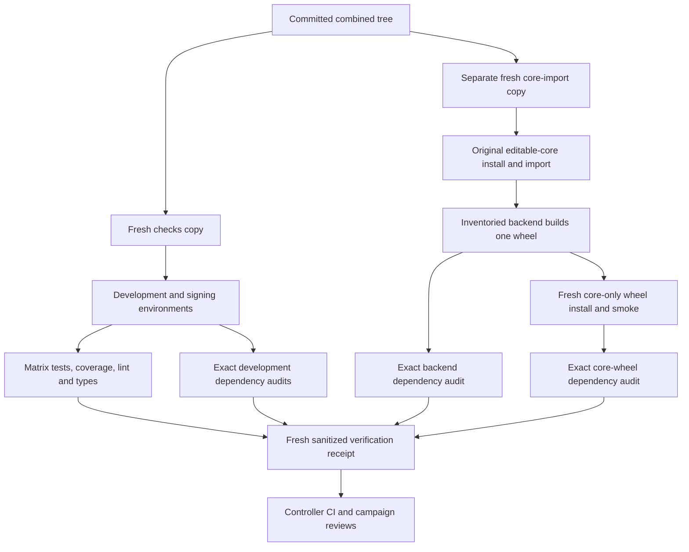

# Preserve CI Steps While Landing Maintenance - Plan

## Goal Capsule

- **Objective:** Maintainers can verify package behavior and dependency health from the checkout and the built wheel.
- **Means:** Restore the held PR #13 payload and make its CI additions preserve the existing checks (KTD1, KTD2).
- **Authority:** Mandate item `foli-9` and the supplied drawdown rules; the chief repository's `docs/plans/2026-10-26-0705-feat-codex-drawdown-campaign-plan.md`, limited to its Goal Capsule and campaign R11, R15, R16, R17, R19, R20. Campaign IDs are distinct from this plan's R-IDs. See Authority availability.
- **Execution profile:** One hygiene item on `drawdown/foli-9`, one controller-published replacement PR. This stage commits only the plan. The later build invokes `lfg` for implementation, simplification, review, verification, and local commits; the controller scans, pushes, and opens the PR, and the campaign gate owns merging.
- **Stop conditions:** Missing source history stops restoration. A dropped CI step, weakened test, absent substantive payload, or incomplete required check prevents build acceptance. A plan-only commit satisfies this planning stage, not the completed item.

---

## Product Contract

### Summary

Land PR #13's tests, audit script, wheel verification, coverage checks, and documentation from `814cb5078b070e75bd7a7111e26854c9ac03380a`.
Preserve the original CI steps and append the new checks, then supply fresh evidence for a replacement PR that supersedes #13 and #10.

### Problem Frame

The campaign held PR #13 because its workflow replaced the two original `core-import` steps.
Its maintenance payload is available locally, but the lane does not yet contain it.
Historical passing receipts do not establish that the final combined tree passes today.

### Requirements

**Restore the maintenance work**

- R1. Restore the complete supplied PR commit range, keeping its substantive script, test, tooling, and documentation changes in the branch diff against `main`.
- R2. Preserve current package behavior, package version 0.5.0, schema/signing version 4, conformance assets, consumer fixtures, migration examples, and every existing test and assertion.

**Preserve and extend CI**

- R3. Keep `Install core dependencies only` and `Verify isolated core import` in `core-import` with their exact original names and commands, before the appended wheel-build, installed-wheel smoke, and dependency-audit steps.
- R4. Keep every other existing workflow step name and effective check; `git diff main -- .github/workflows/ci.yml` must remove no `- name:` line.
- R5. The full suite must pass in fresh environments installed with `.[dev,signing]`; retain Python 3.11, 3.12, and 3.13 checks, lint, types, and the restored 97% combined statement/branch coverage floor.
- R6. Retain the PR's inventoried wheel build, isolated installed-wheel smoke, and exact dependency audits, including rejection of incomplete, vulnerable, or failed audit results.

**Evidence and delivery**

- R7. Documentation and the new verification receipt must describe the combined workflow and distinguish fresh results, historical receipts, and pending controller checks.
- R8. Work only this item: no spend, sends, production-data or credential access, security-setting changes, deploy changes, unbacked deletion, or force-push; add no migration, data rewrite, package release, or new outside service.
- R9. Keep commits local on `drawdown/foli-9` without adding a remote or seeking credentials; the controller's replacement PR and build-stage final message must say it supersedes #13 and #10.

### Key Decisions

- **Complete durable hygiene within the campaign.** Governs R1, R8. (session-settled: user-directed — chosen over speculative features after planned work and worthwhile expansions: finish useful maintenance.)
- **Use the campaign publication and merge gate.** Governs R9. (session-settled: user-directed — chosen over holding guarded work for routine personal approval: the controller and campaign gate finish delivery.)

### Scope Boundaries

The restoration is confined to the payload inventory below and the additive workflow correction.
No runtime `src/folio_propositions/` change appears in the source range; the audit script is executable source, so R1 does not require inventing a library patch.
New regression cases are justified only by a demonstrated integration defect within this item.

There is no frontend change and no screenshot requirement for this scope.
The local wheel is a verification artifact; the source PR's existing public advisory query does not add an outside service.
A permanent workflow-testing framework, new lockfile policy, unrelated dependency upgrades, and a hosted coverage service are not proposed: direct workflow comparison and the restored smoke/audit checks cover this repair.
Reconsider only if fresh evidence exposes a gap those checks cannot detect.

---

## Planning Contract

### Reverified starting state

Static inspection on 2026-11-21 established these facts; no repository tests, installs, builds, or audits ran during planning.

| Evidence | Implication |
|---|---|
| Clean `drawdown/foli-9` at `92a30ab2ee5b206ecd688d88938fae76208ba8ce`; no remote | Preserve this supplied lane baseline and commit only the plan in this stage. |
| Local `main` is `90f94bea43ce6f63176cd6271c7006c72f528dd3`, older than the lane | Its diff includes pre-existing work; also compare the item against the captured lane baseline. |
| Required source head `814cb5078b070e75bd7a7111e26854c9ac03380a` exists | No fetch or credential is needed. |
| Source merge base is the lane baseline; ten source commits follow it | Restore that complete range during build, preserving the planning commit. |
| `main` and the lane baseline have identical `.github/workflows/ci.yml` | One immutable workflow baseline establishes the original step names and commands. |
| The source range changes 15 files and has no `src/` changes | Restore the actual payload rather than creating unrelated production changes. |
| Source already repairs accepted-wheel fixtures for package 0.5.0 | Keep that repair and its stale/wrong-origin rejection cases. |
| Source `Test` adds a condition excluding Python 3.11 | The additive repair must retain the original unconditional console test step (KTD2). |

No repository or accessible ancestor `AGENTS.md`/`CLAUDE.md` was present.
`docs/handoffs/`, `.planning/`, and `docs/solutions/` were absent.
The existing CI and consumer-landing plans supply local conventions; source PR receipts remain historical evidence.

### Authority availability

The chief repository, campaign plan, and `ops/drawdown/mandates/_common.md` are unavailable in this isolated lane.
The Goal Capsule and cited campaign R-IDs could not be independently read.
References to them rely on the supplied standing rules; the controller must compare those exact sections before build acceptance.
This is an authority-source limitation, not a request for credentials or a user-only decision.

### Source payload inventory

These are the 15 paths changed between the captured lane baseline and the supplied source head.

| Paths | Intent to retain |
|---|---|
| `.github/workflows/ci.yml`, `pyproject.toml`, `.gitignore` | Coverage tooling, separate wheel and audit checks, generated-output ignores. Apply R3 and R4 when restoring the workflow. |
| `scripts/audit-dependencies.sh`, `tests/test_dependency_audit.py` | Exact inventories, restricted local origins, complete advisory-result checks, and offline failure-path tests. |
| `tests/core_smoke.py` | Six standalone installed-wheel checks, including provenance, package data, migration, signing-payload protocol, rejection, and replay. |
| `tests/test_interchange.py`, `tests/test_signing.py` | Migration dispatch/input ownership and signing-input boundaries with positive controls. |
| `README.md`, `docs/README.md` | Current behavior and reproducible maintenance checks. |
| `docs/plans/2026-10-26-1419-chore-foli-3-maintenance-assurance-plan.md`, `docs/plans/2026-11-11-0253-chore-land-maintenance-assurance-plan.md` | Historical plan provenance; this plan governs `foli-9`. |
| `docs/plans/evidence/foli-3-verification.md`, `docs/plans/evidence/foli-3-audit.md`, `docs/plans/evidence/2026-11-11-foli-8-verification.md` | Dated historical receipts, preserved without presenting them as fresh results. |

### Key Technical Decisions

- KTD1. **Cherry-pick onto the supplied lane.** Restore the entire merge-base-to-source-head range under R1, retaining current work under R2. Do not reset to the older local `main`. Resolve any overlap in favor of the current tree plus PR intent, and verify an empty commit's payload before skipping it.
- KTD2. **Keep the existing workflow checks additive.** Use the workflow at `92a30ab2ee5b206ecd688d88938fae76208ba8ce` as the immutable reference for R3 and R4. Keep `Test` running `pytest -q` on every matrix leg, and add coverage separately on Python 3.11. Preserve existing job identity, action pins, permissions, concurrency, and timeouts; append the source wheel/audit steps after both original core steps.
- KTD3. **Reproduce CI job isolation locally.** The checks job and core-import job both create `.venv`. Verify them in separate fresh copies of the same committed tree so the signing-enabled environment never contaminates the core-only proof. Keep temporary Git metadata so Ruff honors `.gitignore`, following the restored README. Retain pre-existing environments and artifacts instead of deleting them (R5, R6, R8).
- KTD4. **Keep package and audit provenance together.** In each verification copy, install the package and run audits from that copy's root. Within the core copy, keep editable core in `.venv`, the backend in `.venv-build`, the installed wheel in `.venv-core`, and the auditor in `.venv-audit`. Use its initially empty `dist/`, record the exact wheel hash, and preserve backend inventories before and after the build. The script permits only its own checkout's editable origin or exact current-version wheel origin (R6).
- KTD5. **Preserve campaign model routing.** Local work uses Astra; cloud builds use default Sol with the controller's Astra and Fable PR reviews. (session-settled: user-directed — chosen over the Sol-first local ladder and a forced cloud model: retain the campaign's distinct execution environments.) Local plan review does not replace those gates (R9).

### Verification flow

The diagram shows the separate job copies required by KTD3 and the artifact ownership required by KTD4.

### Assumptions and deferred evidence

The supplied lane tip is treated as the controller's intended current-code base; only the controller can compare the actual publication base.
That assumption does not authorize moving local `main` or fetching a replacement.

Interpreter availability, dependency resolutions, test counts, measured coverage, advisory results, and actual job duration remain build-stage observations.
Do not reuse the historical receipt's pass counts as acceptance evidence.
A network or tooling failure leaves its check failed or pending for the controller; offline auditor tests cannot establish current vulnerability absence.

### Research anchors

`docs/plans/2026-10-09-ci-drain.md` establishes the original matrix and core-import checks.
The source head's maintenance plan and receipt explain the fixed wheel-version fixture and the need for Git metadata in fresh verification copies.
`tests/core_smoke.py` checks actual wheel provenance and uses an independent schema-4 payload oracle; `tests/test_signing.py` supplies real cryptographic coverage that its recording verifier does not.
The source auditor and its tests define accepted origins and fail-closed report validation.

---

## Implementation Units

### U1. Restore the complete maintenance payload

**Goal:** Recover the substantive source work on the current lane.
**Requirements:** R1, R2, R8, R9; KTD1.
**Dependencies:** Available source object and a rechecked clean branch state.
**Files:** All 15 paths in Source payload inventory, including `tests/core_smoke.py`, `tests/test_dependency_audit.py`, `tests/test_interchange.py`, and `tests/test_signing.py`.

**Approach:** Restore the ten source commits in dependency order. Keep this plan and current consumer, migration, and conformance work. Preserve the source's metadata-driven wheel fixture and all negative cases; historical plans do not override this item's workflow rule.

**Patterns to follow:** Existing pytest monkeypatch/subprocess cases and the standalone stdlib wheel smoke.
**Test seam:** The restored pytest files cover dispatch, signing, and audit refusal behavior; only the isolated wheel smoke proves installed packaging.

**Test scenarios:**

1. Migration downgrade or missing-step failure leaves inputs unchanged; no-op nested results are independent copies, and registered callbacks run in order.
2. A freshly signed Ed25519 payload passes the positive control. The restored cases reject wrong key lengths or DID codecs, overlong signature text, a one-character value, non-ASCII text, and signatures decoding to 63 or 65 bytes.
3. The auditor accepts complete pins and exact current origins, while rejecting stale/misplaced wheels, unknown URLs, incomplete reports, vulnerabilities, and nonzero auditor exits.
4. The installed wheel preserves provenance, `py.typed`, JSON/null round trips, v3-to-v4 migration, independent payload bytes, rejected-signature input ownership, and ordered replay.

**Verification:** The item delta contains the inventory's executable script and tests, every pre-existing test remains, and restored scenarios pass under the Verification Contract.

### U2. Preserve original CI checks and append maintenance checks

**Goal:** Remove the documented hold reason while retaining the restored maintenance gates.
**Requirements:** R3, R4, R5, R6, R7; KTD2, KTD3, KTD4.
**Dependencies:** U1.
**Files:** `.github/workflows/ci.yml`, `README.md`, `docs/README.md`; verification uses `tests/core_smoke.py` and the restored pytest files.

**Approach:**

1. Restore both original core-import steps verbatim from the recorded baseline; keep their order and job membership.
2. Append `Build wheel with an inventoried backend`, `Verify installed core wheel`, and `Audit exact backend and core dependencies`, using the source's explicit environment paths.
3. Preserve the original checks-job steps, add `Test with branch coverage` on Python 3.11, and retain `Audit exact development and signing dependencies` after the original quality checks.
4. Explain both core proofs and their separate local checkout in the development instructions; do not describe editable import as installed-wheel verification.

**Patterns to follow:** The baseline workflow's six named steps and the source's explicit interpreter paths.
**Execution note:** Compare the original steps before installation checks; then validate each job in its own fresh copy.
**Test expectation:** No new configuration-only unit suite is needed. Compare step names, command blocks, job membership, order, and conditions against the immutable baseline, then exercise the actual installation and smoke checks.

**Verification:** No removed `- name:` line appears in the required main diff. Both core command blocks are unchanged, the original console test runs on all three versions, and the appended checks succeed without adding signing or audit tooling to either core environment.

### U3. Establish fresh acceptance evidence and hand off locally

**Goal:** Give the controller reproducible proof for the corrected combined tree.
**Requirements:** R1, R2, R5, R6, R7, R8, R9; KTD3, KTD4, KTD5.
**Dependencies:** U1 and U2.
**Files:** A new dated `docs/plans/evidence/` receipt for `foli-9`, `README.md`, `docs/README.md`; all test paths listed in the Verification Contract.

**Approach:** Verify a committed combined snapshot, record the tested commit/tree and wheel hash, and label later receipt-only changes separately. Link the new receipt as current while retaining historical receipts. Record both the delta from the captured lane baseline and the required main comparison. Finish with local commits for controller publication under R9.

**Test expectation:** No new behavior is introduced by the receipt. Run the Verification Contract and record actual results, including unavailable checks.
**Verification:** Fresh evidence identifies its snapshot, runtime versions, dependency resolutions, commands, outcomes, and remaining hosted checks. Committed material contains only public-safe repository-relative paths and sanitized dependency information.

---

## Verification Contract

All runtime checks below belong to the build stage.
Use fresh environments installed from the combined tree with `.[dev,signing]` for development checks, and KTD3's separate core checkout for the original core commands.
Do not overwrite pre-existing virtual environments, remove artifacts, lower coverage, add exclusions, or skip tests to obtain a pass.

| Check | Required outcome |
|---|---|
| Source comparison against the captured lane baseline and `main` | Script, test, and tooling payload is present; prior lane work remains intact. |
| `git diff main -- .github/workflows/ci.yml` | No removed `- name:` line; semantic comparison also preserves baseline commands, conditions, order, and job membership. |
| Workflow and shell validation; `bash -n scripts/audit-dependencies.sh` | Workflow parses and embedded shell/script syntax is valid without credentials or hosted execution. |
| `pytest -q tests/test_interchange.py tests/test_signing.py tests/test_dependency_audit.py` | Restored regression cases pass without weakened assertions. |
| `pytest -q` on Python 3.11, 3.12, and 3.13 | Full suite passes through the same console entry point as the original CI step. |
| Python 3.11 `coverage run -m pytest -q` and `coverage report` | Full package branch measurement passes the source's 97% combined floor. |
| `ruff check .`, `mypy src`, and `python scripts/generate_conformance.py --check` | Lint, types, and current generated conformance remain valid. |
| Baseline `Install core dependencies only` and `Verify isolated core import` command blocks | Exact original commands succeed in the separate core copy; cryptography is absent. |
| Inventoried wheel build and `.venv-core/bin/python -I tests/core_smoke.py` | Backend inventory is unchanged; all six smoke methods pass against the recorded wheel in site-packages without cryptography. |
| `scripts/audit-dependencies.sh` against each development/signing environment, the actual backend, and the core wheel environment | Exact inventories receive complete successful advisory results; tooling is isolated and all refusal paths remain enforced. |
| Documentation, diff, and receipt inspection | Links resolve, historical evidence is labeled, and no generated environments, raw local paths, secrets, or abandoned experiments enter the diff. |

Preserve failures and their diagnostics; a failed or unavailable required check prevents an unqualified acceptance claim.
The controller must compare its actual publication base, repeat checks if integration changes the tree, and complete hosted CI and campaign reviews before merging.

---

## Definition of Done

- U1 through U3 satisfy their linked requirements and the complete Verification Contract with fresh evidence.
- R3 and R4 hold against both the recorded baseline and the controller's publication base.
- The completed build contains the substantive maintenance payload; this planning commit alone is not publishable as a completed item.
- The controller has reconciled the unavailable campaign Goal Capsule and cited R-IDs before accepting the build.
- The final diff contains no abandoned experiments or unrelated changes; cleanup preserves unbacked data under R8.
- The build-stage final message says the new PR supersedes #13 and #10, and reports `BRANCH: drawdown/foli-9`, this plan's path, and `KIND: planned` for this hygiene item.
- No user decision or held change is currently identified. If one emerges, use the campaign's `## Needs your decision` format with the need, setting, minutes, and what it unblocks; use `## Held change` for any explicitly necessary held work.
